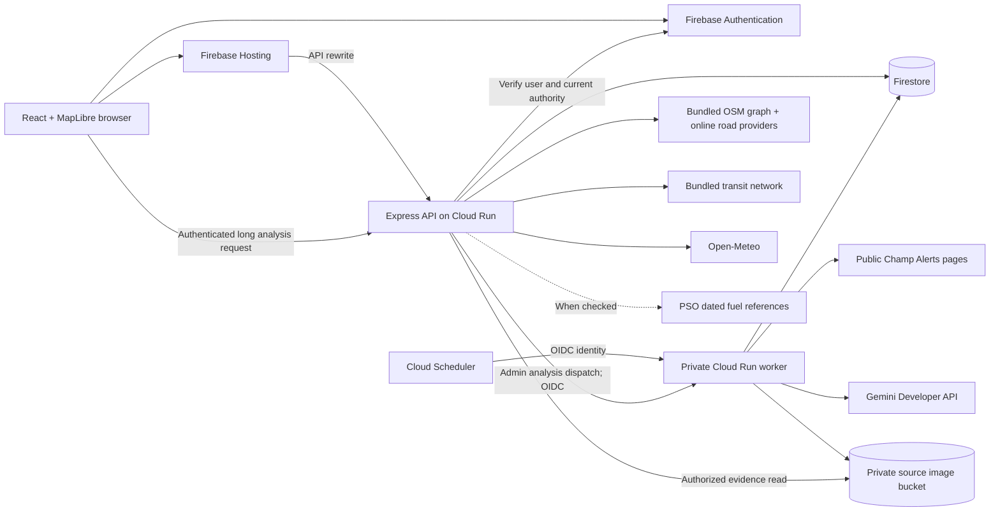

# Manzil architecture

Manzil combines scheduled road restrictions, closure-aware driving routes and Twin Cities public transport in a 2D map. The application separates public travel information, private account data and administrator-reviewed source interpretation.

This document describes the code in this checkout. [Implementation status](docs/IMPLEMENTATION_STATUS.md) distinguishes shipped work, feature-branch work and remaining limitations. Deployment history belongs in the operations documentation, not in the architecture contract.

## System overview

The browser also fetches map tiles/styles from OpenFreeMap. Neither map rendering nor normal driving routes require Google Maps. The diagram shows supported service boundaries; an arrow does not mean every optional service or schedule is enabled.

## Runtime modes

| Mode | Identity and storage | Use |
| --- | --- | --- |
| `local` | Loopback-only, single-user development administrator; SQLite | Fast isolated development. This is not multi-user production authentication. |
| `emulator` | Firebase Auth and Firestore emulators in a `demo-*` project | Local user, moderator and administrator flows; disposable sample accounts. Cloud fallback is rejected. |
| `production` | Firebase Auth, Firestore, explicit HTTPS origins/hosts, attached service identities | Firebase Hosting and separate Cloud Run API/worker services. Local database/auth and emulator settings are rejected. |

`server/bootstrap.ts` chooses the repository adapter. `server/config.ts` validates the runtime before traffic is accepted. `server/index.ts` runs the same image as either API or worker; the worker does not expose the browser API. See [environments](docs/operations/CONFIGURATION.md) and [local setup](docs/engineering/LOCAL_DEVELOPMENT.md).

## Code map

| Location | Responsibility |
| --- | --- |
| `src/App.tsx`, `src/components/` | Map, planner, Local, moderation, profiles, activity and administrator workspace. |
| `src/lib/` | Auth/API boundary, cancellable location and speech, map overlays, route/transit state and browser utilities. |
| `shared/` | GeoJSON domain contracts, source/agent/transit/fare/weather types and shared calculations. |
| `server/app.ts`, `server/validation.ts` | HTTP authorization, validation, request-scoped repositories and API orchestration. |
| `server/community.ts` | Current account authority, contributor verification, closure visibility/edit permissions and minimal user directory. |
| `server/repository.ts`, `server/store.ts`, `server/firestore-store.ts` | Shared persistence contract, SQLite and transactional Firestore adapters. |
| `server/routing/` | Local road graph, driving alternatives, closure/time validation, Pakistan-wide adapters, places and road selection. |
| `server/transit/` | Validated bundled network, bounded transfer search, service restrictions and dated fare references. |
| `server/source*.ts` | Bounded public-source collection, normalization, deduplication and private image evidence. |
| `server/agent*.ts`, `server/gemini.ts` | Interpretation, limits/leases, map preparation, review decisions and private-worker dispatch. |
| `server/weather.ts`, `server/fuel.ts`, `server/commutes.ts`, `server/speech.ts` | Hourly weather, dated fuel checks, saved-journey alerts and optional cloud speech. |
| `assets/routing/`, `assets/transit/`, `public/` | Committed derivatives/provenance, map artwork, branding and on-demand basic Urdu navigation audio. |
| `scripts/`, `config/`, `tests/` | Reproducible import/build/operations tools, public configuration templates and regression tests. |

## Core contracts

- Coordinates are GeoJSON **`[longitude, latitude]`**. Never silently swap UI/provider latitude-first formats into domain objects.
- API instants include an explicit timezone; storage uses ISO timestamps. Display and scheduling use **`Asia/Karachi`**.
- A **road closure** describes a selected continuous road interval. A **blockade** describes a short line across the obstructed road. Its footprint must not close an unrelated road interval.
- Only published, approved restrictions affect public routing. Starts, ends, unknown expiry and the selected map time govern visibility and conflicts.
- Public routing reads a restriction snapshot and revision. Updates, moderation and agent decisions validate expected revisions; stale work fails explicitly instead of overwriting a newer decision.
- Asynchronous client work belongs to its current account, selection and request. Cancellation and late-result guards prevent stale requests from replacing current map/profile state.
- Missing provider data, timetable gaps, uncertain service and unknown prices remain explicit. Synthetic fixtures are never promoted to live evidence.

## Driving, road selection and Local are different systems

| System | Data and behavior | Boundary |
| --- | --- | --- |
| Map rendering | MapLibre with OpenFreeMap styles/tiles; app overlays for routes, restrictions, location and transit. | A visible road does not prove routing or operator data is complete. |
| Driving | Bundled Islamabad OSM graph when all stops are covered; online OSRM-compatible routing elsewhere in Pakistan. Alternatives are checked against restriction geometry and traversal time. | Pakistan endpoints/stops; ordinary road-speed estimates, not live congestion. No promise of three valid alternatives when connectivity does not support them. |
| Closure editor | Bundled graph fast path; bounded Overpass neighbourhood with a small OSM map-API fallback elsewhere. Snapping and blockade checks use actual mapped public roads. | No Islamabad-only gate; provider availability, maximum section/geometry sizes and mapped access still apply. Two-dimensional road centrelines do not establish lane or bridge-level certainty. |
| Local transit | Committed Twin Cities network with stop order, timetable evidence, shape provenance and road-aligned estimates. Bounded walking/transfer search returns eligible imported-network options. | No live vehicle tracking. Missing road connections or schedules are not invented; walking links are estimates rather than pedestrian navigation. |

Road restrictions make an overlapping transit line **uncertain**; a reviewed service notice can confirm suspension for a line, direction or stop interval. Grey availability is separate from visually fading unrelated lines when a user selects a journey. Fares are dated references with partial/unknown totals, not ticket sales or guaranteed future tariffs.

Read [driving](docs/reference/ROUTING.md), [road coverage](docs/reference/ROAD_COVERAGE.md), [closure workflow](docs/guides/CLOSURE_WORKFLOW.md), [transit routing](docs/reference/TRANSIT_ROUTING.md) and [transit data](docs/data-sources/TRANSIT_DATA.md) before changing these boundaries.

## Source-to-map review flow

1. The source collector reads bounded, accountless public Champ Alerts/X HTML. Normalization preserves original evidence, publication observations and source revisions; deduplication prevents repeated ingestion from becoming repeated incidents. Public access is partial and may be blocked.
2. The private worker claims an eligible notice with durable limits/leases, optionally reads bounded private image evidence, then asks Gemini for structured interpretation. Model secrets remain on the worker.
3. Deterministic preparation resolves available road/landmark or transit evidence and creates **private proposals**. Missing/ambiguous geometry, line scope or time remains unresolved or clearly identified for review.
4. An administrator opens evidence and analysis beside the list, reviews the proposal on the map and approves or rejects it. Every agent map change requires administrator approval; enabling automatic publication is rejected by the API.
5. Approval atomically rechecks source/proposal/target revisions and manual overrides, then publishes the road restriction or transit service notice. New routing reads the new revision.

Community submissions use a separate path: ordinary users submit pending reports; verified contributors and administrators review them and may correct eligible reports. Editing a pending report does not approve it. Community reviewer authority does not grant Gemini approval, pipeline control or user-administration authority. See [agent review](docs/operations/AGENT_MAP_REVIEW.md), [transit review](docs/operations/AGENT_TRANSIT_REVIEW.md) and [admin workspace](docs/guides/ADMIN_WORKSPACE.md).

## Storage, privacy and trust

Firestore shared records live beneath `manzil/v1`; personal records live beneath `users/{uid}`. The API selects a repository scope for each authenticated request. The browser has no direct Firestore access: `firestore.rules` denies client reads/writes and server authorization governs Admin SDK operations.

Firebase tokens are verified, and enabled-account/current administrator claims are checked on the server. Contributor verification is server-managed metadata. The administrator directory exposes limited account/profile and consent information, never another user's GPS history, vehicle or trips.

Personal trip recording requires consent. Navigation samples must meet freshness/precision checks; approximate browser positions remain approximate. Retention removes raw points after 30 days and trip summaries after 90 days when the retention sweep runs. Local and cloud sweep mechanisms differ; this is application cleanup, not an independent database TTL guarantee.

Source images use a private Cloud Storage evidence path, with bounded reads and expiry metadata; bucket lifecycle policy is an operator concern. Source text/images and model output are untrusted data, never instructions to execute. Keep SQLite databases, GPS traces, raw source archives, sessions and secrets out of Git and container build context. See [privacy/data](docs/reference/PERSONAL_TRAVEL_DATA.md) and [source deployment](docs/operations/DEPLOYMENT.md).

## Integration and scheduling inventory

| Integration | Implemented role | Activation / limitation |
| --- | --- | --- |
| Firebase Auth / Firestore | Account identity, per-user persistence, shared reports, revisions and review transactions. | Emulator or production configuration; no SQLite fallback in cloud mode. |
| Hosting / Cloud Run | Static client, API rewrite and separate private worker. | Deployments are explicit operator actions; local builds do not publish. |
| Cloud Scheduler / IAM | Authenticated `/internal/tick` jobs; API may dispatch only analysis with its allowed service identity. | A supported job is not necessarily a configured/enabled schedule. |
| Champ Alerts public X pages | Five-minute collector contract, deduplication and partial-access diagnostics. | Enabled setting and worker/local mechanism required; no login-wall bypass or WhatsApp integration. |
| Gemini Developer API / Secret Manager | Bounded source interpretation and private map proposals. | Configured worker, key, limits and enabled analysis required; every map change still needs admin review. |
| Open-Meteo | Shared hourly Islamabad forecast cache; selected-hour weather and eligible trip-share snapshot. | Weather is a location-specific model estimate; outside the forecast horizon is unavailable. Production refresh finishes during the request. |
| PSO fuel archive | Once-per-PKT-day check, petrol/diesel dated references and vehicle estimates. | Cloud scheduled refresh requires its own enabled job; unsupported products/outlet costs remain outside the estimate. |
| Browser location / speech | Foreground location, browser notifications, English/device Urdu voice and bundled basic Urdu fallback. | User/device permissions and hardware accuracy apply; no background GPS guarantee. |
| Google Cloud Text-to-Speech | Optional server synthesis with cache and application usage cap. | Disabled unless explicitly configured/authorized; the basic Urdu fallback does not require it. |

Actual enabled deployment jobs, model limits and release state are maintained in [implementation status](docs/IMPLEMENTATION_STATUS.md), [Gemini operations](docs/operations/GEMINI_INTEGRATION.md) and the deployment runbooks. Do not infer live activation from an SDK dependency or `.env.example`.

## Extension points

Add a new source at the normalized notice/evidence boundary, a new model through the structured interpretation boundary, or a new road provider behind the routing adapter. Preserve validation, resource limits, provenance and review gates in each case. Add operator transit data through the import/verification pipeline rather than drawing plausible routes in the UI. Changes to persistence must work for both repository adapters and preserve request-scoped privacy.

Contributor workflow and verification expectations: [CONTRIBUTING.md](CONTRIBUTING.md). Detailed agent orientation: [agent guide](docs/engineering/AGENT_GUIDE.md).
