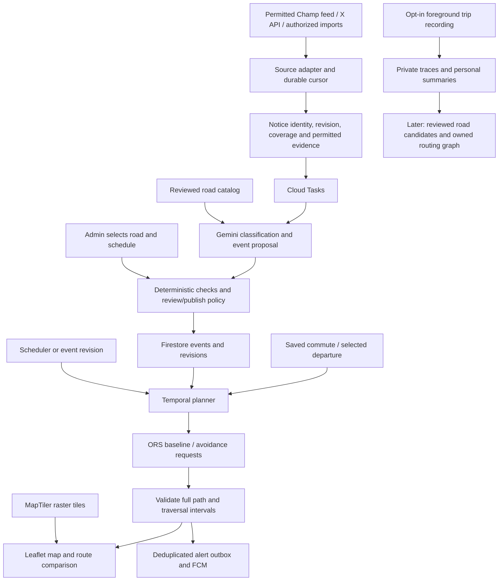

# Manzil: Final Architecture and Implementation Plan

**16 October update:** local/production configuration and Auth/Firestore adapters are now implemented, with standalone SQLite retained. The same API/domain code runs against local emulators or explicitly configured cloud services; verified tokens, user-owned records, admin mutation permissions, durable speech accounting, worker entry points and container/Hosting build files are present. **Nothing is deployed and Gemini extraction remains unimplemented.** The [environment guide](docs/ENVIRONMENTS.md) is authoritative for current behavior. Earlier provider/model/Google-sign-in/source selections below remain historical proposals and must not override current user decisions.

Original decision: 14 October 2026, Asia/Karachi; two developers aiming for 17 October. **Current implementation, updated 15 October:** localhost only; MapLibre GL JS/OpenFreeMap flat vector map, a real local OSM road graph, three-route comparisons, Express/SQLite, local profile/preferences, consented journey alerts and approximate foreground navigation. X public collection attempts run every 15 minutes; Gemini comes later. Read [the redesign guide](docs/REDESIGN_2026-10-15.md), [implementation status](docs/IMPLEMENTATION_STATUS.md) and [retained context](PROJECT_CONTEXT.md). The Leaflet/MapTiler rendering sections below are superseded research history. Cloud/ORS/Firebase sections remain future integration proposals, not services currently running.

## 1 The decision in one page

Build a **simple, fast 2D web app inspired by Safar's clarity**. Users plan/save a commute, see relevant scheduled closures, compare a valid detour with a departure change, and optionally record a trip for personal analytics.

| Part | Selected implementation |
| --- | --- |
| Web app | React + TypeScript + Vite; a small responsive interface |
| Interactive map | Leaflet, ordinary raster tiles; no WebGL/3D requirement |
| Basemap | MapTiler Dataviz Light raster, current style ID dataviz-v4-light, 256px tiles |
| Routes | Hosted openrouteservice (ORS), car profile initially |
| Spatial checks | Backend Turf modules plus reviewed OSM road-segment geometry |
| API/worker | Node.js + TypeScript on Cloud Run; one codebase/image, separate API and private-worker deployments |
| Gemini agent | Google Gen AI SDK on the Google Cloud model endpoint; initially test stable gemini-3.1-flash-lite against our extraction fixtures |
| Data/accounts | Firestore Standard + Firebase Authentication with Google sign-in |
| Background work | One Cloud Scheduler job + Cloud Tasks for durable, bounded jobs |
| Notifications | Firebase Cloud Messaging web push, with an in-app alert inbox |
| Trip traces/evidence | Private Cloud Storage objects where retention is permitted; Firestore stores metadata/summaries |
| Hosting/operations | Firebase Hosting frontend; Secret Manager, Cloud Logging, Artifact Registry |
| Automatic intake under the no-subscription constraint | Start with verified public APP RSS, then Police HTML; time-box an unofficial linked-account WhatsApp Channel client. X promotional-credit API and Android relay remain conditional alternatives |
| Intake contract that works independently | Authorized notice text/image/file import; same processing pipeline as live connectors |

**Traffic is deferred.** ORS durations are ordinary estimates; personal recorded-trip statistics are labelled historical observations, not city-wide live traffic.

**The agent and admin can create closures in Manzil's event layer.** The planner passes their reviewed geometry into ORS avoidance requests and validates the resulting routes. Drawing a blockage does not edit MapTiler tiles or the provider's road graph.

**Road discovery is an evolution of this architecture.** Collect opt-in observations now where feasible; reviewed missing-road candidates become routable later through an owned graph/provider adapter. Hosted ORS does not accept arbitrary new roads from our app.

Live source collection is the material external access dependency. No complete Champ archive, platform credentials, publisher permission or API call has yet been established for this project. The [subscription-free ingestion research](CHAMP_ALERTS_INGESTION.md) records a successful accountless public X preview/detail check, its limited timeline depth, a conditional $20 API incentive, and experimental device/direct-feed alternatives. The first build session must resolve the chosen connector's access before presenting it as live.

Follow-up source checks established a working public APP RSS feed with a current Islamabad traffic advisory and documented unofficial WhatsApp Channel methods in whatsapp-web.js/Baileys. These are different evidence levels: RSS retrieval was tested; linked-account Champ retrieval/live delivery was not. See sections 9–10 of the ingestion research for the bounded experiment and revised source priority.

## 2 Architecture and responsibilities



The API deployment handles client requests after Firebase identity verification. A separate public source-webhook route accepts only provider-authenticated notices, including X CRC handling and raw-body signature verification if that connector is enabled. It durably stores receipt plus extraction intent, acknowledges promptly, and leaves AI work to the private worker. The private worker handles source polling/catch-up, extraction, rechecks and delivery. Scheduler/Tasks invoke the worker with a Google service identity; ordinary browser users cannot invoke its cost-generating job endpoints. Both deployments share domain services and contracts.

Use Cloud Run request billing/minimum instances zero and bounded instances/timeouts. Retain job state and cursors in Firestore, not process memory. Cloud Tasks retries are at-least-once; use idempotent handlers and client notification deduplication rather than claiming exactly-once delivery.

Finish and durably record a task's work before returning success. Do not return a successful HTTP response and leave untracked computation running afterward; chunk/reschedule long work within the task deadline.

## 3 Map and interface

### 3.1 Concrete map setup

Use Leaflet with tileSize 256 and zoomOffset 0:

```text
https://api.maptiler.com/maps/dataviz-v4-light/256/{z}/{x}/{y}.png?key=OUR_BROWSER_KEY
```

Keep the key/domain restrictions, style URL, attribution and logo in configuration. Show MapTiler attribution/logo and OpenStreetMap contributor attribution without covering them with panels. The older dataviz-light ID is deprecated. [Style identifiers](https://docs.maptiler.com/sdk-js/api-reference/variables/Externals.MAP_STYLE_CONFIG/) · [Attribution](https://docs.maptiler.com/guides/map-design/attribution/add-attribution/)

MapTiler's Free plan currently permits noncommercial use and commercial R&D, includes 100,000 API requests/month and pauses at quota; a 256px raster tile consumes a request. It suits a bounded development prototype, not an unlimited commercial launch. Production needs the appropriate plan. Test authenticated Islamabad rendering in the first session. [Pricing](https://www.maptiler.com/cloud/pricing/) · [Terms](https://www.maptiler.com/terms/cloud/)

### 3.2 Screen layout

- **Main view:** map with one compact trip panel: From, To, departure date/time, Plan.
- **Result:** baseline and validated option, departure/arrival, extra distance/time, source and freshness.
- **Saved trips:** weekly commute times and preferences; no continuous GPS required.
- **Alerts:** changed, cancelled, still-active or uncertain events affecting the user.
- **Record trip / My activity:** explicit start/stop and simple personal duration/distance/history.
- **Review/admin:** notice queue, road-segment selection, schedule fields, publish/correct/reopen.

On mobile the panel becomes a bottom sheet. No auto-rotating camera, animated traffic particles or continuous map re-centering. Use clear status text/symbols as well as color. Start with map clicks and a small original landmark list for endpoints; location search is a later provider integration.

### 3.3 Performance rules

Keep a single Leaflet map instance. Update layers without recreating the map or putting every GPS sample into React state. Use the canvas renderer for numerous vector features; show current/candidate-relevant events, not lifetime notice history. Fetch on explicit trip/time changes, cancel stale requests, and debounce map-driven lookups.

Keep Turf on the backend; load recording/analytics/admin code when needed. Use ordinary provider/browser tile caching, not server tile scraping, bulk prefetch or an offline tile downloader. The first performance budget is interactive controls within three seconds on a representative mid-range phone/connection and responsive pan/zoom during a local closure layer. These are test targets, not measured claims.

## 4 Champ Alerts: confirmed sources and intake decision

Champ's [first-party hub](https://linktr.ee/ChampAlertsOnTheGo) and channel description crosslink the following:

| Source | Confirmed address | Connector decision |
| --- | --- | --- |
| X | [@shaheryarhassan](https://x.com/shaheryarhassan) | Conditional official API candidate using verified promotional credit. Public recent preview/detail reading worked, but complete-day discovery and unattended polling were not established. |
| WhatsApp | [CAOTG channel](https://www.whatsapp.com/channel/0029Va8PLrl7j6gBLA3Y5m3J) | Reference/authorized forwarding or publisher-assisted import. No supported arbitrary Channel-history reader established. |
| Facebook | [ChampAlertsOnTheGo](https://www.facebook.com/ChampAlertsOnTheGo) | Secondary adapter only after Meta permissions/App Review or a publisher-authorized integration. |
| Instagram | [@champalertsonthego](https://instagram.com/champalertsonthego) | Secondary adapter if professional-account discovery/access requirements are met; current account type not verified. |
| WhatsApp traffic/bus communities | Linktree's TU-I/R 103, TU-I/R 101 and Public Buses I/R-5 | Invite links do not grant API access; no community harvesting assumption. |
| Publisher feed/archive | None established | Best future path: author-provided webhook/JSON/RSS/Sheet/archive under an agreed data contract. |

No verified working publisher website/RSS, official Telegram or YouTube alert stream was found. An email domain does not establish a feed. The same-named Bluesky lead had one old post, no verified crosslinks and no useful current stream; exclude it from operational sources.

Facebook is a real but permission-gated possibility: [Page Public Content Access](https://developers.facebook.com/docs/features-reference/page-public-content-access/) requires review/business verification. Instagram [Business Discovery](https://developers.facebook.com/documentation/instagram-platform/instagram-graph-api/reference/ig-user/business_discovery) can expose another Business/Creator account's media with the appropriate caller/account/token permissions. Neither is an immediate anonymous “read everything” API or a reliable three-day approval assumption.

### 4.1 What “all posts” means

The requested historical import remains a separate work item. Its completion must report the actual accessible date range and gaps:

- X user timelines expose up to the latest **3,200** posts, with pagination and incremental IDs.
- Recent search covers **seven days**.
- Full-archive search is available with qualifying paid access; deleted/protected/unavailable items are not guaranteed recoverable.
- WhatsApp's admin report covers recent updates, not a lifetime archive; no general channel-history API was established.

[X timelines](https://docs.x.com/x-api/posts/timelines/introduction) · [X search](https://docs.x.com/x-api/posts/search/introduction) · [WhatsApp reports](https://faq.whatsapp.com/6480469855345352/?cms_platform=web)

Operational completeness means **all retrievable new posts from each connected, authorized source, with checkpoints and visible gaps**. It does not mean all Champ posts on every platform are identical or recoverable. A publisher's original archive is the strongest backfill route.

### 4.2 Access, budget and processing gate

The user does not want to buy a subscription. Use an official connector only after a no-purchase promotional balance and permitted use are established; do not enable auto-recharge or buy credits. The conditional first-card incentive, expiry and budget are detailed in the [ingestion decision](CHAMP_ALERTS_INGESTION.md#31-x-credits-a-useful-temporary-route). Prioritize new notices over historical backfill; X and Google credits are separate.

For prompt delivery, first test X Activity API public `post.create`/`post.delete` webhooks filtered to Champ's verified author ID, with incremental timeline recovery. Provider documentation supports public-account app authentication, but actual entitlement/delivery is untested. These event-filter registrations do not require a monthly subscription; per-event costs still consume credit. [Activity API](https://docs.x.com/x-api/activity/introduction) · [Specific event pricing](https://docs.x.com/x-api/activity/event-pricing) · [Webhook validation/acknowledgement](https://docs.x.com/x-api/webhooks/introduction)

If no credit/card is available, a strictly filtered, explicitly permitted Android notification relay is a bounded experiment; usable Champ identity/text and real delivery must be tested before adoption. A publisher's original webhook/Sheet/Telegram feed is the preferred ongoing route if cooperation is established. Keep share/paste/image import throughout. Public accountless reading succeeded, but the preview reached a sign-in boundary after a few recent posts and is not a verified complete feed. [Full observations, alternatives and execution gate](CHAMP_ALERTS_INGESTION.md)

X's terms/developer policy constrain scraping, geographical-data reuse, redistribution/removals and model training. A post URL alone does not establish permission for a separate operational geospatial dataset. Check permitted inference/downstream event use, and the publisher's rights, before enabling that adapter for the closure database. If it is not permitted, use the publisher's own licensed feed/archive or authorized original notices; do not route around a restriction through an unofficial mirror. [Agreement](https://docs.x.com/developer-terms/agreement) · [Policy](https://docs.x.com/developer-terms/policy)

For inference, select the Google Cloud Gemini endpoint rather than unpaid product-improvement processing of imported social content. Google's Cloud model terms restrict training use without permission; that does not erase source-platform restrictions or imply zero retention. [Cloud data governance](https://docs.cloud.google.com/vertex-ai/generative-ai/docs/data-governance)

This is an access/rights check, not a reason to stop building the planner. The authorized-import adapter runs the complete same workflow and provides a truthful demo while a live connector is being established. Label each notice's intake method.

### 4.3 WhatsApp clients and non-social sources

The next no-payment source spike is APP RSS plus deliberate Champ import, with a two-hour whatsapp-web.js linked-account Channel experiment. No supported arbitrary-Channel API was established, but unofficial libraries do expose recent-message retrieval and event machinery. They require deliberate account linking, protected session storage and source filtering, and carry platform/account/reliability risks. Do not equate documented library methods with a verified live Champ connection.

Run any browser/socket collector as a separate persistent process; the current minimum-zero request worker is not an always-connected host. The collector posts to authenticated Manzil intake and does not run in users' browsers. Add the official Police HTML adapter after testing its listing/detail extraction; NHMP direct availability remains unresolved. [Concrete methods, source checks and acceptance gates](CHAMP_ALERTS_INGESTION.md#9-direct-whatsapp-channel-clients-a-real-unofficial-option)

## 5 Ingestion and historical backfill

1. Configure the allowed adapter and label its actual intake/coverage mode. For an API/feed, resolve/cache the verified author ID where required; notification/manual input cannot claim the same source-history coverage.
2. Prioritize current-day new notices and any relevant still-active older/future events. Historical backfill is a separate deferred task under the no-purchase budget.
3. Prefer a verified provider webhook for prompt intake, with periodic incremental catch-up. If only a permitted timeline/feed works, poll initially every 60–120 seconds within actual endpoint/account limits and verified balance. Device adapters enqueue on receipt with their own partial-coverage limits.
4. Save each item's identity/revision and pending extraction outbox entry atomically before acknowledging push receipt or advancing a polling cursor. For paginated polling, freeze the first page's newest ID as the window upper bound, paginate the window and commit only that bound after receipts/job intents are durable; later arrivals belong to the next run. Keep IDs as strings and use a connector lease to prevent overlapping runs.
5. A retrying dispatcher enqueues one idempotent extraction job per pending notice revision. Periodically scan the pending outbox to recover a crash between database commit and task creation; idempotency also handles duplicate deliveries. Preserve original publication time, ingestion time, canonical source, permitted evidence and repost/forward context. Never wait for Gemini inside a source webhook's acknowledgement deadline.
6. Classify closure, congestion, reopening/cancellation, unrelated, duplicate or uncertain. Do not silently exclude all replies or assume every post is a traffic restriction.
7. Link duplicated cross-posts to one event where justified. Copies/forwards do not count as independent corroboration.
8. Match corrections/reopenings to the existing event and create a revision. Re-evaluate affected trips.
9. Retry with backoff and checkpoint recovery; expose last successful sync, covered dates, missing windows and backfill state.
10. Reconcile upstream edits, deletions and protected/unavailable status through the permitted API/compliance mechanism. Update/remove retained source material within the applicable policy requirements and revise dependent evidence. If an event loses its only usable evidence, mark it for re-review; a deleted post is not proof that the road reopened. Budget for reconciliation calls before enabling the connector.

Old imported events stay historical unless an explicit current/future interpretation passes review. Relative phrases such as “tomorrow” use original publication time in Asia/Karachi, not the import date.

Raw source retention/display/deletion must follow its actual contract. Metadata IDs/coverage and original synthetic fixtures can live in the repository; private traces, copied social archives and credentials cannot. An ingestion log should not become an indefinite unlicensed content archive.

## 6 Gemini agent and event publication

Use bounded tools through the Google Gen AI SDK:

- findRoadCandidates: aliases, official names, junctions and permitted road IDs.
- inspectRoadSegment: reviewed direction, access and geometry context.
- proposeEvent / proposeRevision: typed drafts with evidence and unresolved fields.

The agent's job is classification and grounded proposals, not inventing coordinates or calculating routes. Start by testing the stable [Gemini 3.1 Flash-Lite](https://docs.cloud.google.com/gemini-enterprise-agent-platform/models/gemini/3-1-flash-lite) with a configurable model ID, token limit and small tool-call budget. Validate outputs against our schema and deterministic road/time checks.

### Publication policy

Both manual and AI proposals use one event service:

1. Authorized admin selects a reviewed road segment or draws geometry, chooses direction and time, then publishes.
2. AI can automatically publish only a permitted, approved source's unambiguous notice matching previously reviewed road geometry, with valid time/direction/evidence and all deterministic rules passing.
3. Ambiguous landmarks, broad areas, unknown directions, unclear time, conflicting updates or new geometry enter the review queue.
4. A model confidence number alone never grants publication. A crash/congestion notice does not imply a complete road closure.
5. Ordinary users may submit a report. They do not gain global publish permission; private user avoidances can be added after the core admin/report flow.

Version every event. Separate announced start/end, observed active/reopened state, unknown end and cancellation. An expected end does not override a later “still blocked” report. Future planning is explicitly schedule-based and should be rechecked before departure.

## 7 Road geometry and temporal rerouting

Build a small reviewed Islamabad road/landmark catalog from permitted OSM data and original admin review. Include aliases such as a road's former/current names, junction boundaries, divided carriageways and known overpass distinctions. Version geometry; do not rely on provider edge IDs surviving graph updates.

### Route procedure

1. Accept origin, destination, car profile and departure/arrival preference.
2. Obtain an ORS baseline and available candidates.
3. Load relevant reviewed city events for the evaluated travel horizon, including unknown-end/still-active events.
4. Estimate each candidate's entry/exit at affected stretches from route steps/geometry. Carry timing uncertainty; these are not live traffic observations.
5. Check overlap of traversal interval with closure interval, not just whether the closure exists at departure.
6. For conflicting reviewed closures, submit narrow avoidance polygons to ORS and request a connected alternative.
7. Validate the entire returned path against all relevant events, including ones outside the baseline corridor.
8. Compare permitted earlier/later departures with a fresh exclusion set and recomputed times.
9. Use one shared maximum of six provider requests per plan, including retries/time choices. Stop on repeated geometry/no progress/timeout.
10. Rank only passing candidates. If none passes, return unavailable/inconclusive, not the blocked baseline.

[ORS options](https://giscience.github.io/openrouteservice/api-reference/endpoints/directions/routing-options)

The spatial exclusions are fixed for each provider query, so this is bounded temporal candidate evaluation rather than a globally optimal time-dependent graph algorithm. ORS polygons can conservatively affect both directions on shared geometry or an overlapping flyover. Unsupported cases require reviewed separate geometry or a visible conservative/inconclusive result; validation cannot recover a path already excluded by the provider.

Cache only as permitted, with keys including provider/profile, endpoints, departure, preferences, road-catalog version and city event revision. A publication/correction/reopening increments the city revision so old results cannot appear current. In-memory cache is an optimization, never the source of correctness.

## 8 Saved commutes and notifications

A commute stores owner, endpoints, weekday rules, Asia/Karachi timezone, usual departure, arrival deadline and allowed departure shifts. Generate occurrences for upcoming checks rather than one Scheduler job per user.

An event revision queues affected occurrences immediately. The shared periodic job finds due occurrences, requests fresh candidates/timing where needed, validates and writes a changed recommendation. Do not reroute every user on every poll or GPS sample.

Use an alert outbox keyed by occurrence and meaningful change/revision. The worker claims it, sends FCM and records delivery attempts. Web notification tags/IDs prevent duplicate retries producing repeated cards. Push requires permission/browser support/service-worker setup; keep the in-app inbox and last-check timestamp. Scheduled checks work without GPS recording or an open map. [FCM web delivery](https://firebase.google.com/docs/cloud-messaging/web/receive-messages)

## 9 Personal analytics and GPS collection

### 9.1 What to implement now

Give the user separate controls for saving a commute, recording a personal trip and contributing observations to road improvement. Saving a commute does not enable tracking.

For an opted-in recorded trip:

- Start/stop explicitly; show an unmistakable recording indicator and elapsed time.
- Use browser geolocation while the document is active/visible. Accept bounded samples with timestamps/accuracy; target one retained sample about every five seconds during movement, subject to actual browser updates.
- Buffer in IndexedDB. Upload a completed trace or recoverable pending upload; do not write each GPS fix as a Firestore document.
- Store raw points privately in a compressed Cloud Storage object, with a Firestore trip summary and bounded simplified personal display geometry.
- Show elapsed trip time, observed distance, recorded route and comparisons with the user's previous trips, including sample count/coverage.
- Mark gaps and poor accuracy. Do not connect missing intervals into an invented drivable shortcut or claim a complete distance where recording was incomplete.

Initial retention policy: private raw/display traces for 30 days, personal summary metrics for 90 days, and user-initiated deletion of both. These are proposed product defaults; implement actual cleanup and deletion, not just policy text. No home/work/GPS data in public analytics or logs.

The [Geolocation standard](https://www.w3.org/TR/geolocation/) delivers updates to active visible documents; a PWA/service worker does not create reliable screen-off tracking. The web prototype must say “keep recording view open.” Reliable background commute recording is a later tested mobile-client capability.

### 9.2 Later: learning missing roads

Keep original consenting observations alongside any derived map matching. Snapping everything to existing roads can destroy the signal that a road is missing.

Shared improvement processing is separately opted in and excludes start/end privacy zones; private trip history is not automatically a public road layer. Retain a private contribution/deletion link while observations are identifiable.

1. Compare quality-controlled traces with a versioned permitted regional OSM road extract, not just our small curated notice catalog.
2. Distinguish an uncatalogued known road, provider graph lag, GPS noise, walking/private access and a potentially missing public motor route.
3. Cluster candidate corridors. Several distinct consenting users/days can trigger review, but no numeric count proves legal vehicle access.
4. Review connectivity, turns, direction, surface, gates/private access and vehicle suitability. Display unapproved candidates only in the admin review layer.
5. Maintain approved original/OSM-compatible road data under appropriate contributor/data terms.
6. Add a self-hosted GraphHopper implementation behind the existing route-provider contract; import/rebuild a versioned regional graph with approved additions.
7. Test real routing through the new edge, access/turn restrictions and closure handling before activation.

Drawing the approved line in Leaflet is easy; making it routable requires the graph step. Do not infer geometry from MapTiler imagery/tiles to build a commercial substitute dataset or automatically edit global OSM from raw crowdsourced traces. [GraphHopper import/deployment](https://github.com/graphhopper/graphhopper/blob/master/docs/core/deploy.md)

## 10 Data and API contracts

| Collection/object | Main content |
| --- | --- |
| sourceConnectors | Verified account ID, access state, cursor, lease, covered dates, gaps, last success and budget |
| notices / noticeVersions | Source identity, original/received times, revision, permitted content reference/hash, intake mode and processing state |
| roadCatalog | Versioned aliases/landmarks, reviewed segments, direction/access/grade metadata |
| roadEvents / eventRevisions | Action, road IDs, geometry reference, schedule, observed status, evidence, review and city revision |
| commutes / occurrences | Owner, weekly time rules, next departure, preferences and evaluation state |
| plans / alerts | Candidate outcome, uncertainty, revision/version keys, evidence and delivery deduplication |
| trips | Owner/consent, recording coverage, summary metrics, trace reference and deletion deadline |
| candidateRoads | Later consented evidence references, quality/access review and graph-promotion status |

Keep GeoJSON as a domain contract. In the selected Firestore Standard edition, an array cannot directly contain another array: serialize bounded geometry as a non-indexed JSON string or reference a Cloud Storage GeoJSON object; store bbox numbers/segment IDs separately. Cap geometry/trace size and keep API responses bounded. [Firestore data types](https://firebase.google.com/docs/firestore/manage-data/data-types)

Public API:

- POST /api/plans; POST /api/commutes; GET /api/me/commutes; GET /api/me/alerts.
- GET /api/events with city/time/bounds filters.
- POST /api/admin/notices; POST /api/admin/events; POST /api/admin/events/:id/revisions.
- POST /api/reports for ordinary user observations.
- POST /api/trips/start; POST /api/trips/:id/finish; GET /api/me/trips; DELETE /api/me/trips/:id.

Private worker jobs: source sync/backfill, notice extraction, occurrence evaluation, alert delivery and retention cleanup. Send IDs/version keys in Tasks payloads instead of duplicating source bodies or GPS traces.

Validate owner/role on every server route; Firestore client rules and Cloud Storage permissions must protect private data too. The browser receives the restricted tile key, never ORS credentials or publisher/API secrets.

## 11 Two-developer implementation sequence

| Date / gate | Developer A | Developer B | Required result |
| --- | --- | --- | --- |
| Oct 14: foundation | Cloud access, ORS baseline/avoidance spike, event schema and route validator | Vite/Leaflet/MapTiler shell, trip panel and map selection | One realistic connected detour, a visible reviewed closure and deployed skeleton |
| Oct 15: source to event | Approved source access test, incremental adapter/import, Tasks and Gemini tools | Admin event creation/scheduling, review queue, source/evidence cards | An authorized notice produces a reviewed event that changes a route |
| Oct 16: personal commute | Saved occurrence scheduling, revision invalidation, FCM outbox and delivery | Saved trips, alerts, foreground recording and minimal personal summaries | A future affected commute generates changed advice and one tested push; recording is accurately labelled |
| Oct 17: freeze and polish | Failure/retry/cancellation/timing checks, costs, demo fixtures and deployment reliability | Mobile readability, empty/loading/error states, performance and demo recording | Complete workflow, clear limitations and submission artifacts |

The first source spike must determine what is actually connected, permitted and affordable. If live access is not ready, retain a functioning authorized-import pipeline and label it in the demo; do not claim an automated scraper. Historical backfill and complete future collection remain explicit deliverables with coverage status rather than hidden behind seeded examples.

Do not spend the deadline implementing a new graph engine, reliable background mobile tracking, automatic road promotion, public transit routing, camera avoidance or city-wide live traffic. Keep schemas/adapters ready for them. A minimally working personal trip recorder/summary can be included; advanced analytics and learned-road processing follow the core closure-to-commute gate.

## 12 Acceptance checks and budget

Before UI polish, test:

1. Normal local route; one closure with a connected bypass; no valid bypass.
2. Closure starts after departure but before crossing; traversal straddles the start; earlier departure clears before start with a margin.
3. Announced end versus still-active update, cancellation and unknown end.
4. Two interacting closures, direction ambiguity and overpass geometry.
5. Source duplicate/correction/outage/gap, upstream deletion/protected-status reconciliation and historical “tomorrow” interpretation.
6. Invalid AI geometry/time, unrelated notice and a permission-limited source.
7. Failed route provider/retry exhaustion returns no falsely clear baseline.
8. Background saved-trip notification on the actual demo browser.
9. GPS permission denial, hidden-tab gap, offline upload recovery and private-data deletion.
10. Phone map responsiveness, quota usage and actual cloud billing.

Use original synthetic fixtures for destructive/error cases and label them. Record timings/request counts and test outcomes; do not claim measured accuracy or current road conditions from fixtures.

MapTiler and ORS quotas must be verified in the actual accounts. Google recurring allowances can cover small compute/database/notification use, but billing/credits and model requests still need budgets. X reads, commercial tiles, source access and external providers are separate. Use a per-plan six-request cap, per-source ingestion/backfill budgets, AI limits, bounded worker retries and spending alerts. The detailed allowances are in the [Google cost section](MAPPING_PROJECT_COMPARISON.md#11-google-integrations-and-first-month-cost-plan).

This plan fixes the initial stack and the product flow. Implementation is the next step; no live scraper, source rights, account entitlement, actual routing quality or performance result is implied by the architecture.
