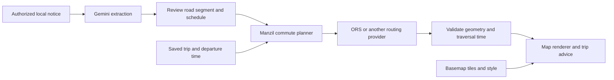

# Manzil: Mapping Projects, Similar Products, and Technology Comparison

> **15 October implementation update:** the owner's supplied Safar **Android** screenshot identifies MapLibre Android + OpenFreeMap + OpenMapTiles + OpenStreetMap. That is distinct from the earlier Safar **website** Leaflet/CARTO finding below. Manzil now uses MapLibre GL JS/OpenFreeMap in flat 2D with cleaner styling, route alternatives and red closures. The current implemented stack and tradeoffs are in [the redesign guide](docs/REDESIGN_2026-10-15.md); earlier technology comparisons remain research history.

Research and architecture comparison for the two-person Manzil team. Updated 14 October 2026, Asia/Karachi. Prototype target: 17 October. This supplements the [implementation plan](ISLAMABAD_COMMUTE_PROJECT_PLAN.md).

**Implementation decision after this research:** the founder chose simple, efficient 2D. Follow [the final architecture](MANZIL_ARCHITECTURE.md): Leaflet + MapTiler Dataviz Light raster + hosted ORS and the Google Cloud/Gemini backend. The 3D comparisons below are retained research, not the current build choice.

## 1 Quick conclusions

1. **Similar ideas already exist.** Waze handles planned closures and advance event alerts. CommuteScout combines road feeds, planning, an AI assistant, and route watches. BoardSpy provides predeparture commute alerts. Manzil should compete on Islamabad notice interpretation, reviewed scheduled events, precise commute-time impact, and understandable recommendations.
2. **Safar's web appearance comes from Leaflet + CARTO Voyager + OpenStreetMap.** Its journey backend is separate. Its public catalog has an OTP-labelled interface, but the current journey engine and a reusable data/API license are not established.
3. **DeFlock and FlockHopper are related but have multiple implementations.** The current web map is MapLibre/Protomaps; DeFlock mobile uses Flutter/flutter_map and requests avoidance routes. An older public FlockHopper router uses GraphHopper. These are not proof that every current branded component is open source.
4. **The selected interface is 2D.** Use Leaflet and MapTiler raster tiles. MapLibre/Mapbox/Cesium capabilities remain useful research for a future visual requirement.
5. **Current Mapbox GL JS has a commercial license.** Public source is not the same as unrestricted open source. Mapbox offers polished 3D and hosted navigation, with separate billing for maps, search, and routing.
6. **A red road overlay does not change a routing engine.** The router must receive exclusions or generate candidates that our backend rejects when they conflict with a reviewed closure.
7. **Borrow architecture and carefully selected licensed components.** Several inspected apps accept warnings or reduced exposure instead of a fully clear route. Manzil must enforce its hard-closure promise.
8. **Google services fit the core workflow even with an open map.** Gemini, Cloud Run, Firestore, Firebase Auth, FCM and one Scheduler job have useful roles. Section 11 distinguishes recurring free allowances from trial credits and lists optional additions.

The selected stack is Leaflet + MapTiler Dataviz Light raster + hosted ORS, with Gemini, Cloud Run and Firestore for our original notice/event/commute workflow. The founder has chosen simple 2D; the final architecture fixes the implementation sequence. Road coverage, route geometry and traversal times in Islamabad still require actual tests.

## 2 The layers we are comparing

| Layer | Purpose | Examples | What it does not establish |
| --- | --- | --- | --- |
| Product/application | The complete experience people use | Safar, Waze, DeFlock, CommuteScout | A product name alone does not reveal its backend or licenses. |
| Map renderer | Draw and interact with the map | Leaflet, MapLibre, Mapbox GL JS, CesiumJS | No automatic road graph, traffic feed, or closure-aware routing. |
| Basemap/style/tiles | Street geography, labels, buildings, visual appearance | CARTO Voyager, OpenFreeMap, Mapbox styles, Protomaps | A tile image is not an editable routing graph. |
| Geographic data | Roads, access, buildings, camera locations | OSM and separately licensed datasets | Open data does not make every service using it open source. |
| Routing engine/API | Calculate connected paths and travel estimates | ORS, GraphHopper, Valhalla, OSRM, Google Routes | Static exclusions alone do not implement our scheduled event model. |
| Manzil planning layer | Decide which closures affect this occurrence of this trip | Our reviewed events, temporal checks, option comparison, notifications | An LLM explanation cannot substitute for route validation. |

The basemap can change from Voyager to a 3D vector style without replacing the notice pipeline or routing adapter. Provider data and service terms still apply to each combination.

## 3 Applications and comparable projects

“Open” below refers to the inspected software scope. It does not mean every hosted server, commercial account, map dataset, image, or external API is included. Public repository code can also differ from a deployed service.

| Project and purpose | Actual map and routing stack | Is the application code open? | Are its mapping/routing tools open? | Benefit and limitation for Manzil |
| --- | --- | --- | --- | --- |
| **[Safar](https://www.safar.fyi/islamabad)** — Pakistani bus/metro discovery and journey planning | Web: Leaflet/React bindings + CARTO Voyager raster tiles + OSM. Own journey API; OTP-labelled transit catalog. Android stack/current journey engine unverified. | Full licensed source repository not established. | Leaflet is BSD; OSM is open data. CARTO tile hosting and Safar transit data have separate terms. | Excellent local transit and clean UI reference. No established partner API/GTFS redistribution entitlement or notice-to-timed-closure integration. |
| **[DeFlock catalog](https://github.com/FoggedLens/deflock)** — crowdsourced surveillance-camera information | Vue/Vuetify initiative; current map moved to the separate MapLibre map project. OSM camera reporting and data. | [MIT web source](https://github.com/FoggedLens/deflock/blob/master/LICENSE). | MapLibre/OSM are open; photographs and external data are separate. | Useful reporting, facing-direction, and provenance concepts. A camera catalog is not a scheduled commuter-closure engine. |
| **[DeFlock Maps / FlockHopper web](https://github.com/FoggedLens/deflockhopper_maps)** — camera map and avoidance comparison | React + MapLibre + Protomaps; separate routing API returns baseline/avoidance results. | [MIT frontend](https://github.com/FoggedLens/deflockhopper_maps/blob/master/LICENSE); current deployed backend/source license not established. | Renderer and Protomaps tools are open; hosted routing implementation is a separate question. | Useful comparison UI and own tile infrastructure. Inspected route interface has no scheduled-event/departure fields. |
| **[DeFlock mobile](https://github.com/FoggedLens/deflock-app)** — mobile camera viewing, reporting, routing | Flutter + flutter_map; configurable tiles. Calls FlockHopper directions with an ALPRWatch fallback. | [AGPL-3.0 app source](https://github.com/FoggedLens/deflock-app/blob/main/LICENSE), unlike MIT web repos. | Flutter/flutter_map are open; configured imagery providers and hosted routes have separate terms. | Shows that DeFlock now includes routing. Native/mobile code is not a ready React web app; dataset completeness and avoidance are not guarantees. |
| **[Older FlockHopper source](https://github.com/flockhopperdev/FlockHopper)** — camera-aware route generation | React/Vite/TS map app; GraphHopper custom models, camera zones, alternative/waypoint strategies. | [MIT repository](https://github.com/flockhopperdev/FlockHopper/blob/main/LICENSE); not proof of the whole current product/iOS/backend. | MapLibre/Leaflet and GraphHopper engine are open; hosted APIs separate. | Strong avoidance-orchestration reference. Near-zero priorities and fallbacks can minimize exposure while retaining a camera crossing; a closed road requires hard rejection. |
| **[Ghostway](https://github.com/DeseretSaint/ghostway)** — camera avoidance with road incidents/work zones | MapLibre + OpenFreeMap; regional OSM graph/on-device A*; Valhalla and other fallback routes; DeFlock/DOT/WZDx inputs. | [GPL-3.0-or-later](https://github.com/DeseretSaint/ghostway/blob/main/LICENSE). | Core renderer/algorithms are open; each feed and hosted service remains separate. | Close combination of cameras and closures. Future trip-zone badge is informational; inspected code does not route against future closures at each segment's arrival time. |
| **[CommuteScout](https://github.com/nicglazkov/commutescout)** — road feeds, planning, AI explanations and route watches | Leaflet containing MapLibre; OpenFreeMap/own Protomaps maps; Stadia Valhalla; Python; Cloud Run/Firestore/Scheduler and Claude tools. | MIT repository for application, parsers, planner, MCP and tests. | Renderers/Valhalla are open. Stadia, inference, delivery and Cloud hosting are external services. | Closest open application reference. Current Caltrans intake skips not-yet-established closures; rerouting may retry without exclusions and return a warning. Our scheduled/hard-closure behavior must differ. |
| **[Waze / Waze for Cities](https://www.waze.com/wazeforcities/)** — navigation and partner closure publishing | Waze map/router, Map Editor, partner CIFS feeds; internal stack proprietary/unverified. | Full current application/router source not published in reviewed official material. | Feed specifications are public; service/engine are not thereby open source. | Mature planned closure and advance event-alert precedent. Partner/editor approval matters; it is not a general customizable routing backend for us. |
| **[Google Maps / Routes](https://developers.google.com/maps/documentation/routes)** — mainstream navigation and developer directions | Google-hosted maps, traffic and routing. | Proprietary product/service; an open wrapper or sample does not open the backend. | Some wrappers are MIT; Maps/Routes and licensed data are commercial. | Familiar search/traffic/navigation. Our application cannot inject arbitrary custom closure polygons into Routes; via-anchor candidates need validation. |
| **[BoardSpy](https://boardspy.site/facts/detour-and-route-change-alerts/)** — predeparture commute alerts | Publisher names Google Maps Platform Routes API; full internal stack unverified. | No official licensed source repo established. | Google Routes is commercial; other internal dependencies unknown. | Close saved-commute, leave-earlier and notification UX. Local notice ingestion/custom scheduled closure processing is not established. |
| **[one.network / Live Link](https://us.one.network/product/live-link/)** — roadworks and closure publication | Commercial road-management platform and integrations with navigation providers; current renderer not independently verified. | Full platform source not published in reviewed material. | Integration specifications/service access are distinct from open source. | Strong publisher/authority and planned-event precedent. Geographic email subscriptions do not establish exact-time per-commute analysis; no drop-in Islamabad feed. |
| **[Organic Maps](https://github.com/organicmaps/organicmaps)** — offline OSM navigation | Own C++ Drape renderer and IndexRouter; downloaded OSM-derived maps. | [Apache-2.0 core](https://github.com/organicmaps/organicmaps/blob/master/LICENSES/Apache-2.0.txt), third-party notices/data licenses separate. | Its renderer/router source is open, rather than a Mapbox/Google frontend. | Offline/privacy architecture and conditional road access precedent. C++ mobile engine and map builds are substantial work for our web deadline. |
| **[CoMaps](https://github.com/comaps/comaps)** — community-led offline navigation | Organic Maps-derived Drape renderer and own IndexRouter, downloadable OSM vector maps. | [Apache-2.0](https://github.com/comaps/comaps/blob/main/LICENSE) plus component/resource notices. | Core renderer/router open. | Similar offline reference with community governance. Not a web notice pipeline; adopting the native app is a different project scope. |
| **[OsmAnd](https://github.com/osmandapp/OsmAnd)** — advanced offline navigation and route preferences | Own native/Java/C++ map and routing stack; OSM vectors and optional online tiles. | [GPL-3.0-or-later code](https://github.com/osmandapp/OsmAnd/blob/master/LICENSE); artwork/UI resources have restrictive and proprietary exceptions. | Core code is open; not every asset or service is freely reusable. | Rich routing profiles and avoid-road UX. Considerable mobile/codebase complexity; copying artwork is not covered by the code license. |
| **[BRouter Web](https://brouter.de/brouter-web/)** — editable routing/no-go areas | Leaflet frontend + BRouter engine; no-go points/polygons/polylines. | [MIT frontend](https://github.com/nrenner/brouter-web/blob/master/LICENSE) and [MIT engine](https://github.com/abrensch/brouter/blob/master/LICENSE), with notices. | Renderer and engine open. | Good obstacle editing and preference reference. No schedules in inspected no-go fields; driving quality needs local tests and demo-server API is not an integration contract. |
| **[ORS Maps / openrouteservice](https://github.com/GIScience/ors-map-client)** — routes and avoid-area planning | Leaflet client + ORS backend, OSM road data. | [Apache-2.0 client](https://github.com/GIScience/ors-map-client/blob/main/LICENSE); [GPL-3.0 backend root](https://github.com/GIScience/openrouteservice/blob/main/LICENSE) with component licenses. | Client/engine open; hosted quotas/result terms separate. | Direct polygon-avoidance reference and recommended hosted router. No live traffic feed or complete notice/scheduled-commute product. |

Safar evidence: [map component](https://www.safar.fyi/_next/static/chunks/3wqiut0e2ggr2.js), [planner bundle](https://www.safar.fyi/_next/static/chunks/3055hou04tf5n.js), [OTP-labelled catalog](https://www.safar.fyi/api/transit/lines), [terms](https://www.safar.fyi/terms). Bundle names may change. Catalog metadata is a clue to the transit interface, not proof of the current v2 journey algorithm.

DeFlock/FlockHopper evidence: [current map component](https://github.com/FoggedLens/deflockhopper_maps/blob/master/src/components/map/MapLibreContainer.tsx), [current route client](https://github.com/FoggedLens/deflockhopper_maps/blob/master/src/services/apiClient.ts), [mobile dependencies](https://github.com/FoggedLens/deflock-app/blob/main/pubspec.yaml), [mobile routing](https://github.com/FoggedLens/deflock-app/blob/main/lib/services/routing_service.dart), [older GraphHopper adapter](https://github.com/flockhopperdev/FlockHopper/blob/main/src/services/graphHopperService.ts), [older configuration](https://github.com/flockhopperdev/FlockHopper/blob/main/src/services/routingConfig.ts). Upstream [flutter_map is BSD-3-Clause](https://github.com/fleaflet/flutter_map/blob/master/LICENSE); it is a Flutter renderer, not the JavaScript Leaflet library.

Offline-app engine evidence: [Organic Maps Drape](https://github.com/organicmaps/organicmaps/blob/master/libs/drape_frontend/drape_engine.hpp), [IndexRouter](https://github.com/organicmaps/organicmaps/blob/master/libs/routing/index_router.cpp), [conditional access](https://github.com/organicmaps/organicmaps/blob/master/libs/routing/road_access.cpp), [CoMaps engine](https://github.com/comaps/comaps/blob/main/libs/routing/index_router.cpp), [OsmAnd router](https://github.com/osmandapp/OsmAnd/blob/master/OsmAnd-java/src/main/java/net/osmand/router/RoutePlannerFrontEnd.java).

## 4 Map renderers, tiles, and 3D tools

| Tool/service | Purpose and source status | 3D support | Benefits | Limitations for Manzil |
| --- | --- | --- | --- | --- |
| **[Leaflet](https://leafletjs.com/)** | Interactive 2D renderer; [BSD-2-Clause](https://github.com/Leaflet/Leaflet/blob/main/LICENSE). | Core focuses on 2D. | Small, familiar, straightforward closure polylines, polygons, markers and popups; matches Safar's approach. | Tiles/search/routes come separately. 3D plugins add complexity; choose a native 3D renderer if that is a priority. |
| **[MapLibre GL JS](https://maplibre.org/)** | WebGL vector renderer; [BSD-3-Clause](https://github.com/maplibre/maplibre-gl-js/blob/main/LICENSE.txt). | Building extrusion, pitched views, terrain/globe and custom layers. | Best open renderer candidate for the desired 3D look; original GeoJSON route/closure styling. | Needs tiles/style/fonts and height/DEM data. WebGL/device performance and Islamabad coverage must be checked. Not all Mapbox-specific features transfer. |
| **[Mapbox GL JS](https://github.com/mapbox/mapbox-gl-js)** | Current renderer has [Mapbox commercial terms](https://github.com/mapbox/mapbox-gl-js/blob/main/LICENSE.txt); source is public. | Polished Standard buildings/landmarks/lighting; separate DEM for terrain. | Convenient hosted style ecosystem and presentation. | Active account/token/service terms; separate billing. Current GL JS is not the BSD-licensed old release; backend/data are not wholly open. |
| **[CARTO Voyager](https://docs.carto.com/carto-user-manual/maps/basemaps)** | Basemap style/hosted tile service, distinct from full CARTO analytics platform. | Safar uses raster 2D; vector styles can be displayed by other renderers. | Clean geography and legible labels; good quiet background. | Current [basemap terms](https://www.carto.com/legal/basemap-terms/) require our key/attribution and restrict navigation/map display in moving vehicles. Use appropriate terms for future GPS views. |
| **[OpenFreeMap](https://openfreemap.org/)** | OSM-based vector tile hosting; MIT project with separately licensed components/data. | 3D style/building data can be used with MapLibre. | Public service advertises free commercial use, no account/key and no map-view/request limit; full deployment source available. | No SLA; it does not supply routes, search, satellite or a terrain DEM. Required attribution and service terms apply. |
| **[Protomaps / PMTiles](https://github.com/protomaps/PMTiles)** | Static tile-file distribution and rendering ecosystem; PMTiles reference implementations BSD-3, specification CC0/public domain. | Depends on renderer and tile contents. | Own regional maps/overlay archives on object storage without a dynamic tile server; used in the camera-map ecosystem. | Must generate/obtain and update datasets; storage/bandwidth still cost. It is not a routing engine or traffic source. |
| **[MapTiler Cloud](https://www.maptiler.com/)** | Commercial hosted styles/tiles/terrain with separate account terms; component SDK source does not open the cloud service. | Vector building and terrain content for compatible renderers. | Convenient data source for a MapLibre project. | [Plan/use terms](https://www.maptiler.com/terms/cloud/) matter; production commercial use differs from allowed R&D/free conditions. Inspect Islamabad detail. |
| **[CesiumJS](https://cesium.com/platform/cesiumjs/)** | Globe/geospatial renderer; [Apache-2.0](https://github.com/CesiumGS/cesium/blob/main/LICENSE.md). | Terrain, 3D Tiles, imagery, models, time-dynamic scenes. | Strong digital-twin and large-scene capabilities. | Road routing is separate; content/ion hosting separately licensed and billed. Scene complexity is unnecessary for the current commuter prototype. |
| **[deck.gl](https://deck.gl/)** | GPU visualization layers; [MIT](https://github.com/visgl/deck.gl/blob/master/LICENSE). | Paths, extrusions, terrain/3D Tiles and data layers. | Later GPS heatmaps, large traces, analytical overlays. | Not a complete street-map or road router. Ordinary route/closure layers need no extra framework; terrain alignment adds work. |
| **[Google Maps JavaScript](https://developers.google.com/maps/documentation/javascript/overview)** | Commercial maps under [Google terms](https://cloud.google.com/maps-platform/terms). | Separate photorealistic 3D experience where available. | Familiar maps, places and traffic with Google integration. | [Coverage](https://developers.google.com/maps/coverage) currently flags Pakistan's Maps JS 3D as unavailable/low availability; do not promise Islamabad photorealistic 3D. Custom closure routing remains separate. |
| **[OpenStreetMap](https://www.openstreetmap.org/copyright)** | Geographic database under ODbL, rather than one renderer/hosted API. | Building/height information may be present in data. | Editable roads, local aliases, access and community contributions; shared foundation for many engines. | Road/detail freshness varies. Public [tile-server policy](https://operations.osmfoundation.org/policies/tiles/) is separate from the database license and is not unlimited production hosting. |

### 4.1 What the Mapbox-like 3D appearance actually requires

A pitched map rotates the view; it does not create building height or terrain. Building extrusion needs footprints and height/level attributes. Terrain needs an elevation model. Photorealistic city meshes are a further data product with different coverage and terms.

MapLibre's official [building example](https://maplibre.org/maplibre-gl-js/docs/examples/display-buildings-in-3d/) uses hosted OpenFreeMap data, so no owned planet tile build is required to begin. Its [terrain example](https://maplibre.org/maplibre-gl-js/docs/examples/3d-terrain/) demonstrates the separate elevation source. Mapbox [Standard](https://docs.mapbox.com/map-styles/guides/standard-styles/) offers its own visual features and [terrain integration](https://docs.mapbox.com/mapbox-gl-js/example/add-terrain/).

For Islamabad, inspect a few representative streets and landmarks before selecting a provider. No verified local building-height completeness or DEM visual assessment has been completed for Manzil. A sparse building layer is a data issue even when the renderer works correctly. Use a top-down mode for precise closure review and an optional modest pitch for presentation.

### 4.2 Cost distinctions

Current Mapbox web map loads have a 50,000/month free tier, followed by $5/1,000 in the next tier. Map initialization counts as a load. Directions/search are separate products, so a free map-load allowance does not make every request free. [Mapbox pricing](https://www.mapbox.com/pricing)

MapLibre/Leaflet/CesiumJS/deck.gl have no per-view renderer license fee under their open source licenses. Tile, content, hosting, search and routing services can still charge. OpenFreeMap's public instance is a practical low-friction candidate, with the absence of an SLA accounted for in the provider adapter. [OpenFreeMap conditions](https://openfreemap.org/tos/)

## 5 Routing engines and services

None of these automatically reads Champ notices or supplies our complete scheduled-closure workflow.

| Engine/service | Open source scope | Custom avoidance | Traffic/time capability | Assessment for Manzil |
| --- | --- | --- | --- | --- |
| **[ORS](https://giscience.github.io/openrouteservice/api-reference/endpoints/directions/routing-options)** | Backend root GPL-3 with component licenses; hosted service/results have separate terms. | Avoid polygons directly per request. | Ordinary estimates; no hosted live traffic feed. | Recommended deadline route API. Our scheduler chooses relevant exclusions and rechecks every candidate's traversal interval. |
| **[GraphHopper](https://github.com/graphhopper/graphhopper)** | [Apache-2.0 engine](https://github.com/graphhopper/graphhopper/blob/master/LICENSE.txt); hosted plans separate. | Custom areas and priorities; zero priority with compatible flexible mode can exclude roads. | Depends on installation/data; open engine is not a bundled live traffic service. | Strong later owned regional router. [Custom models](https://github.com/graphhopper/graphhopper/blob/master/docs/core/custom-models.md) need compatible settings; hosted free plan is not equivalent to unrestricted self-hosting. |
| **[Valhalla](https://github.com/valhalla/valhalla)** | [MIT engine](https://github.com/valhalla/valhalla/blob/master/COPYING); hosted offerings separate. | Excluded locations/polygons, depending on API and deployment. | Time-dependent requests; optional historical/live traffic needs supplied data. | Good alternative if a tested deployment/account already exists; CommuteScout uses hosted Stadia Valhalla. [API](https://github.com/valhalla/valhalla/blob/master/docs/docs/api/route/api-reference.md). |
| **[OSRM](https://github.com/Project-OSRM/osrm-backend)** | [BSD-2-Clause](https://github.com/Project-OSRM/osrm-backend/blob/master/LICENSE.TXT). | Configured class exclusion; arbitrary dynamic road changes require data/customization operations. | Speed updates possible; no free universal live traffic source included. | Fast baseline/matrix engine, less convenient for request-specific changing polygons. [Traffic operations](https://github.com/Project-OSRM/osrm-backend/wiki/Traffic). |
| **[BRouter](https://github.com/abrensch/brouter)** | MIT engine. | No-go points, polygons/polylines and weighted rules. | Profile-derived estimates; event schedule layer remains ours. | Useful obstacle UX/algorithm reference; local driving and server support need testing. |
| **[Google Routes](https://developers.google.com/maps/documentation/routes/reference/rest/v2/TopLevel/computeRoutes)** | Commercial hosted API. | No arbitrary closure-polygon field; road-aware via-waypoint candidates can steer detours. | Traffic-aware estimates and future departure options. | Viable traffic-first path, with more candidate-search work and licensed display/storage constraints. All returned candidates require our event checks. |
| **[Mapbox Directions](https://docs.mapbox.com/api/navigation/directions/)** | Commercial hosted API; public client SDKs do not open the service. | Beta custom excluded points snapped to roads, up to 50; best-effort exclusions can report violations. | Driving-traffic and future departure; segment duration annotations available. | More capable for custom avoidance than “only generic road types.” Points are not full scheduled polygons; reject violations/conflicting geometry. |
| **[HERE Routing v8](https://docs.here.com/routing/docs/routing-v8-avoid-area)** | Commercial hosted API. | Bounding boxes, polygons and corridors; specific segment IDs also supported. | Traffic/time-aware capability where supported; Pakistan is listed as Entry Map, not established navigable coverage. | Rich avoidance API, but not a ready Islamabad router. Avoidance violations and large-area approximation are additional limits. |
| **[TomTom Routing](https://docs.tomtom.com/routing-api/documentation/tomtom-maps/v1/calculate-route)** | Commercial hosted API. | POST avoidAreas with up to ten axis-aligned rectangles. | Pakistan routing supported; current table does not list Pakistan real-time traffic. | Potential routing alternative, not an established local live-traffic upgrade. Rectangles may overblock nearby roads; validate geometry and account conditions. |
| **[OpenTripPlanner](https://github.com/opentripplanner/OpenTripPlanner)** | [LGPL-3.0-or-later](https://github.com/opentripplanner/OpenTripPlanner/blob/dev-2.x/LICENSE). | Multimodal/transit network and alert/update processing. | GTFS schedules and supported realtime updates. | Future bus/metro planner once authorized local feeds exist. Not an easy replacement for missing schedule/operator data. |

Mapbox's current [coverage guide](https://docs.mapbox.com/help/dive-deeper/directions/) lists Pakistan for real-time and typical traffic. That is a documented service capability, not proof of timely measurements on every Islamabad road. Test actual local routes and sudden closure conditions before making a quality claim.

HERE lists Pakistan among [Entry Map countries](https://docs.here.com/routing/docs/routing-v8-non-navigable-countries); its [coverage definitions](https://docs.here.com/routing/docs/routing-v8-coverage-levels) describe basic display/search, rather than established turn-by-turn navigation. TomTom's [current market table](https://docs.tomtom.com/routing-api/documentation/tomtom-maps/v1/product-information/market-coverage) marks Pakistan Calculate Route support while leaving real-time traffic unlisted. These local limits matter more than attractive global feature lists.

For all engines, event relevance should follow estimated arrival at the affected stretch, with uncertainty margins. A request exclusion is normally fixed for that query: it does not by itself allow a road that will reopen midway through a journey. Recompute and validate each permitted departure option; bounded candidate search is not proof of a globally optimal temporal route.

## 6 Who has worked on a similar idea?

### 6.1 Closest open application: CommuteScout

CommuteScout is a close architectural precedent, not merely a renderer library. The inspected application includes official incident feeds, provenance/freshness, route watches, AI tools, and notifications. Its Google Cloud backend demonstrates that an open map frontend can coexist with Cloud Run, Firestore and scheduling.

At inspected revision 48de6cefc84d81cd8126aeacabcbf885f3e2fd3e:

- [Basemap implementation](https://github.com/nicglazkov/commutescout/blob/48de6cefc84d81cd8126aeacabcbf885f3e2fd3e/src/ca_roads_demo/static/basemap.js) shows the Leaflet/MapLibre integration, OpenFreeMap styles and own Protomaps files.
- [Routing client](https://github.com/nicglazkov/commutescout/blob/48de6cefc84d81cd8126aeacabcbf885f3e2fd3e/src/ca_roads_demo/valhalla.py) uses Stadia's Valhalla endpoint.
- [Caltrans parser](https://github.com/nicglazkov/commutescout/blob/48de6cefc84d81cd8126aeacabcbf885f3e2fd3e/src/ca_roads/feeds/lcs.py) skips scheduled-but-not-established closures. Our planned-event handling would need its own semantics.
- [Planner](https://github.com/nicglazkov/commutescout/blob/48de6cefc84d81cd8126aeacabcbf885f3e2fd3e/src/ca_roads_demo/routing.py) sends trusted closure exclusions, but can retry without them and return a warning. Manzil must not describe that result as closure-free.
- [Watches](https://github.com/nicglazkov/commutescout/blob/48de6cefc84d81cd8126aeacabcbf885f3e2fd3e/src/ca_roads_demo/watch.py) and [architecture](https://github.com/nicglazkov/commutescout/blob/main/docs/architecture.md) are useful notification/freshness references.

Study trust tiers, source-specific adapters and original fixture evaluations. Avoid adopting the full product or adding an MCP server before Manzil's essential rerouting flow works.

### 6.2 Mature planned-closure precedent: Waze

Waze's official partner workflow supports planned road closures and reviewed traffic events with advance notifications. Its event categories include demonstrations and summits; targeting uses frequent travel or saved places in affected areas. Thus the claim “navigation apps only discover a closure once it happens” is too broad. [Planned closures](https://support.google.com/waze/partners/answer/10617147?hl=en) · [Advance event workflow](https://support.google.com/waze/partners/answer/16523846?hl=en)

Its [CIFS specification](https://developers.google.com/waze/data-feed/road-closure-information) and [drive planning](https://support.google.com/waze/answer/6378906?co=GENIE.Platform%3DAndroid&hl=en) demonstrate scheduled information and time-to-leave concepts. Manzil's potential advantage is local information that has not reached those systems, translated into a reviewed event and a specific user's travel decision. Future authorized publication to established navigation providers could expand impact; partner access is not assumed.

### 6.3 Social information becomes route exclusions: ORS example

The official [flood-avoidance example](https://openrouteservice.org/example-avoid-flooded-areas-with-ors/) uses historical geolocated tweets, keyword-labelled reports, buffered areas, and ORS avoid polygons to compare baseline and detour. Its visualization uses Folium, a Leaflet-based Python map wrapper. This is direct prior art for social-report-to-avoidance routing.

It does not establish today's X access, future announcement interpretation, road alias resolution, recurrent commutes or a modern production app. Use the pattern; rebuild source intake and geometry review for our actual authorized notices.

### 6.4 Closures, operational schedules and rerouting: SchoolRide

[SchoolRide's authors](https://scopelab.ai/files/iccps2026_schoolride.pdf) describe CAD/social incident feeds and GPS, OSM/OSRM routing, PostgreSQL, a Plotly dashboard, an LLM status chatbot, and parent notifications. Their closure handling updates graph edges and travel matrices before constrained bus replanning. This is a close disruption-response precedent, aimed at school fleet dispatch rather than individual commuter planning. A complete licensed source repository was not established; the paper does not prove LLM extraction of future local notices.

### 6.5 Cameras plus future work zones: Ghostway

Ghostway combines more of the founder's longer-term ideas than a camera-only map. Its [traffic code](https://github.com/DeseretSaint/ghostway/blob/main/src/traffic.js) loads incidents/work zones; [trip UI](https://github.com/DeseretSaint/ghostway/blob/main/src/main.js) displays date-overlapping zones. That badge is informational: future closures do not change today's route. Date/bounding-box overlap is different from predicting when a vehicle crosses each closed segment.

Its [local router](https://github.com/DeseretSaint/ghostway/blob/main/src/router.js) and [Valhalla integration](https://github.com/DeseretSaint/ghostway/blob/main/src/valhalla.js) illustrate regional graph routing and fallbacks. Inspected closure behavior can slow an edge or retain a baseline; preserve our independent hard-rejection rule.

### 6.6 Other adjacent products and research

| Project | What overlaps | Openness and relevance |
| --- | --- | --- |
| [BoardSpy](https://boardspy.site/blog/when-commuters-need-to-leave-earlier-2026/) | Configured commutes and predeparture delay/detour alerts using Google Routes. | Product claims and API choice are first-party; whole source/backend not verified. Useful alert UX, no established notice-to-scheduled-event pipeline. |
| [one.network communication](https://us.one.network/product-group/communicate/) | Authoritative planned road events, geographic subscriptions and navigation-provider distribution. | Commercial platform. Publisher integration model matters more than copying its map style. |
| [HAAS Alert](https://www.haasalert.com/government) | Verified live hazards delivered into navigation/vehicles. | Commercial connected-service infrastructure. Mainly immediate active-hazard warnings; provenance/distribution reference. |
| [RUI paper](https://arxiv.org/abs/2307.00323) | Road-information updates and notifications; authors use Google Maps API. | Paper available; licensed full implementation not established. Adjacent local-news/road-information idea. |
| [Traffic Event Extractor](https://github.com/Haidi927/Event-extraction-and-Traffic-flow-prediction) | GPT/LangChain extracts structured traffic information from news; downstream event/traffic modelling. | Source visible, no explicit license established. No verified complete commute planner; study the concept, not reusable code. |
| [MobiVerse](https://github.com/ucla-mobility/MobiVerse) | LLM-assisted responses to disruptions in a SUMO mobility simulation. | [Academic research license](https://github.com/ucla-mobility/MobiVerse/blob/main/LICENSE.txt), with commercial/redistribution restrictions; not permissive open source or a consumer navigator. |
| [UrbanSync](https://github.com/RahulBansal-24/Urbansync) | MapLibre/TomTom city dashboard, incident/route-scoring and simulation claims. | No license established. Source has synthetic route fallback and identifier-based incident scoring; visual reference, not evidence of validated hard-closure routing. |
| [FlockFree Navigation](https://github.com/yetisoldier/FlockFree-Navigation) | OsmAnd-derived camera avoidance and self-hosted GraphHopper privacy routes. | GPL code with restricted artwork exceptions; US-oriented coverage. Substantial native-app scope, not our web deadline base. |
| [Ghost Route](https://github.com/DevvGwardo/ghost-route) | Camera ranking over OSRM alternatives and waypoint detour synthesis, MapLibre/CARTO appearance. | MIT source; documented architecture/dependencies verified, not a full execution audit. Similar avoidance-search pattern. |

UrbanSync source inspected at revision 4d85b431bf8c50480dca6695b33e0fb871ea1af7: [map](https://github.com/RahulBansal-24/Urbansync/blob/4d85b431bf8c50480dca6695b33e0fb871ea1af7/frontend/src/components/map/CityMap.tsx), [router](https://github.com/RahulBansal-24/Urbansync/blob/4d85b431bf8c50480dca6695b33e0fb871ea1af7/backend/app/services/routing/smart_route_engine.py). It uses TomTom night raster tiles when keyed, otherwise a CARTO vector style. Pitch alone does not prove 3D terrain/buildings. Synthetic paths or a hardcoded confidence value must not appear as verified routes in Manzil.

## 7 What distinguishes Manzil

The defensible product statement is: **Manzil turns local disruption notices into source-backed, time-specific commute decisions for Islamabad.**

| Requirement | Existing overlap | What we must implement or demonstrate |
| --- | --- | --- |
| Local Urdu/Roman Urdu/English notices | News extraction prototypes; Waze accepts reviewed event details. | Grounded extraction, original source time, road aliases/landmarks, meaningful uncertainty and correction. |
| Future closure periods | Waze/one.network events; timed road-access engines. | Reviewed segment/direction and start/end/unknown-end model; do not expire an active closure merely because expected end passed. |
| Saved recurring commute | BoardSpy/CommuteScout watches and mainstream planned-drive tools. | The next occurrence's departure and segment crossing times, not just “event is near home.” |
| Detour versus early leave/wait | Alternative-routing and optimization systems. | Compare only validated paths/time choices, include waiting and arrival deadline, preserve uncertainty. |
| Source-backed explanation | CommuteScout provenance/AI tools, publisher workflows. | Show why this specific trip changes and which notice/revision caused it. |
| Hard closure rejection | Engines can exclude roads; some apps accept exposure/warnings. | Reject every known conflicting route and expose unavailable/inconclusive results when search fails. |
| Metro/bus disruption | Safar ordinary transit; OTP/GTFS realtime ecosystem. | Authorized local route/service mapping and operator updates; data access before full multimodal routing. |
| Crowdsourced reports | Waze/DeFlock/CommuteScout community reports. | Independent corroboration, trust, freshness and review rather than raw report count alone. |
| GPS history and learned paths | Offline navigation/trace and map-matching ecosystems. | Opt-in histories, legal/access checks and road review. A repeated trace does not prove a public, drivable road. |
| Camera avoidance | DeFlock/FlockHopper/Ghostway/FlockFree. | Separate privacy module, regional coverage and exposure validation; not a required hackathon differentiator. |

There is substantial overlap, but no verified reviewed project exactly establishes the complete Islamabad source/language/schedule/commute workflow. That supports a focused product opportunity, not a claim to be first worldwide. Demonstrating local notice cases and measurable valid recommendations is more convincing than a large feature list.

## 8 Recommended options for this deadline

| Option | Choose when | Advantages | Work and tradeoffs |
| --- | --- | --- | --- |
| **Leaflet + permitted Voyager/OSM tiles + ORS** | Fast familiar 2D implementation is the priority. | Safar-like appearance, simple layers, direct polygon avoidance. | Ordinary ETAs; respect tile terms. Does not deliver native Mapbox-like 3D. |
| **MapLibre + OpenFreeMap + ORS** | 3D/pitched visual design matters and the teammate can implement it promptly. | Open renderer/data path; hosted tiles; engine unchanged; no owned tile build needed. | Inspect WebGL and Islamabad buildings. DEM is separate; keep top-down mode. Best open 3D candidate. |
| **Mapbox GL JS + Mapbox Directions or another permitted router** | Its exact presentation or traffic API is preferred and account access is ready. | Polished 3D, hosted styles/navigation and documented traffic. | Commercial renderer/API terms, separate usage charges; point exclusions are best effort. Same hard-validation requirement. |
| **Google Maps + Routes via-anchor candidates** | Google traffic/search/familiarity outweigh additional detour-search work. | Strong familiar hosted services and future traffic estimates. | Custom closure injection unsupported; more candidate generation; Islamabad photorealistic 3D not promised. |
| **MapLibre + self-hosted GraphHopper/Valhalla** | A working regional deployment already exists or after the hackathon. | Own graph/control; custom data and avoidance tuning. | Imports, memory, updates, traffic acquisition, deployment and monitoring. High deadline risk if starting fresh. |

These are engineering assessments, not measured benchmarks. Do not implement every option. Keep one route-provider adapter and one renderer for the submission.

A short visual spike should settle the frontend choice: display an Islamabad route, reviewed closure and clickable evidence card; inspect mobile performance and building data. Use hosted ORS for the first connected-detour test. If the 3D candidate causes setup/data problems, use the simpler renderer without changing the product's core acceptance criteria.

## 9 Features worth borrowing or adding

1. **Source freshness per provider:** show publication and last-check times; do not turn old notices into confidently current closures.
2. **What changed:** notify on a correction, cancellation or still-active update, not repeatedly on the same notice.
3. **Scheduled-event preview:** a time slider changes visible events and the evaluated trip; future versus active labels remain explicit.
4. **Latest evaluated departure choice:** provide a practical earlier window with an uncertainty margin, rather than a falsely exact last safe minute.
5. **Trust and review tiers:** separate authoritative/partner notices, reviewed extraction and unconfirmed crowd reports.
6. **Corridor watch:** useful alerts without continuous GPS or an exact private home address.
7. **Publisher event form:** future Champ/operator partnership supplies precise segment/time corrections directly.
8. **Notice interpretation preview:** highlight which source phrase produced the road, time and direction, then request missing facts before publication.
9. **Detour comparison card:** added distance/time, arrival, waiting, evidence, and why an option was rejected.
10. **Provider-neutral map layers:** road-event features belong to Manzil, so changing tile appearance does not discard event data.

Use [WZDx's CC0 specification](https://github.com/usdot-jpo-ode/wzdx) as a reference for geometry, time, lane impact and producer metadata. It is a schema, not a ready local feed or route engine.

## 10 Reuse and implementation gates

Prioritize fresh original application code with focused licensed library reuse. MIT/BSD/Apache projects are practical reference/component candidates with notices preserved. GPL/AGPL components require understanding the obligations for the intended use; code licenses do not cover every map dataset or artwork file. A public repository with no license is source-visible, not an established copying permission.

Before committing to a stack, prove:

1. A real connected baseline route in supported Islamabad corridors.
2. A different valid route around an original synthetic reviewed closure.
3. Correct traversal-time checks near start/end boundaries and for each departure option.
4. Full-path validation against multiple closures, with conservative handling of direction/grade ambiguity.
5. No successful “clear route” response when the provider violates avoidance, returns a fictional fallback, or exhausts search.
6. A cancellation/still-active revision invalidates the prior trip result.
7. One tested unattended notification path, if that is promised in the demo.
8. A readable map in 2D and, if selected, a usable optional 3D presentation.

The complete testing, source-access, cost-control and two-developer milestone plan remains in [the main developer brief](ISLAMABAD_COMMUTE_PROJECT_PLAN.md). This comparison changes our understanding of competitors and the frontend alternatives; it does not establish a running application, live source access, or tested provider quality.

## 11 Google integrations and first-month cost plan

Checked against official product documentation on 14 October 2026. A small prototype can plausibly use several of these services without a charge for a month or longer. That depends on the actual account, region, selected API/model, usage and associated resources. A recurring free allowance is not an unlimited free service or a spending cap.

### 11.1 Recommended meaningful integrations

Use Google services for the notice-to-commute workflow with the selected Leaflet/MapTiler/ORS map and detours:

1. **Gemini:** propose structured road events from authorized notices, optionally read screenshots, and explain already validated travel choices.
2. **Cloud Run:** host our extraction, review, route-validation and commute-evaluation API.
3. **Firestore:** retain reviewed events/revisions, sources, private saved commutes, preferences and notification deduplication.
4. **Firebase Authentication with Google sign-in:** identify users and protect their saved journeys; reviewer/admin permissions are a separate server-side role.
5. **Firebase Cloud Messaging:** deliver the source-backed “your next commute changes” notification.
6. **One Cloud Scheduler job:** invoke the backend to evaluate upcoming occurrences even when no user has the app open.
7. **Firebase Hosting, if useful:** serve the static React frontend with HTTPS/CDN; Cloud Run can alternatively serve the frontend, so this is a deployment choice.
8. **Secret Manager and Cloud Logging:** support credentials and troubleshooting rather than appear as artificial user-facing features.

This already makes Google AI and Cloud central to the solution. Additional services should solve a concrete problem or replace implementation work; do not add them merely to increase the count.

| Google service | Manzil use | Current no-cost allowance or credit route | Important condition |
| --- | --- | --- | --- |
| **Gemini Developer API / AI Studio** | Text/image notice extraction, local-language interpretation and explanation of validated choices | Selected models, including listed Flash-Lite options, have free-tier input/output; account/model rate limits apply. [Pricing](https://ai.google.dev/gemini-api/docs/pricing) | Confirm the project's actual tier and current supported model. Free quota is not unlimited; billable model/tools/features differ. Keep public/synthetic input separate from private commuter information. |
| **Gemini through the Google Cloud model endpoint** | Cloud-native inference alternative for the same extraction contract | Usage is priced by model/tokens; eligible Cloud credits can offset covered services. It is not a blanket recurring free inference entitlement. [Cloud model pricing](https://cloud.google.com/vertex-ai/generative-ai/pricing) | Distinguish this from the Developer API in AI Studio. Verify model access, billing and promotional-credit scope before selecting it. |
| **Cloud Run service** | API and scheduled evaluation worker | Request-billing allowances: 2M requests, 180,000 vCPU-seconds and 360,000 GiB-seconds/month on the listed Tier-1 pricing basis. [Pricing](https://cloud.google.com/run/pricing) | Billing account required; account-wide discounts, regional prices, network, builds and artifacts affect cost. Use request billing/minimum instances zero; do not leave an always-running process for this prototype. |
| **Cloud Firestore Standard** | Events, revisions, commutes and alert state | One eligible database/project: 1 GiB storage, 50,000 reads/day, 20,000 writes/day, 20,000 deletes/day, 10 GiB outbound/month. [Pricing](https://firebase.google.com/docs/firestore/pricing) | Query/listener/index reads count. Backups, PITR and TTL deletes are outside free usage. Scheduled event expiry is application logic, not a reason to enable TTL automatically. |
| **Firebase Auth: Google sign-in** | Account login and private saved journeys | Base Auth nonphone services are no-cost. [Pricing](https://firebase.google.com/pricing) · [Integration](https://firebase.google.com/docs/auth/web/google-signin) | Optional Identity Platform has different quotas/features; do not upgrade just to enable Google sign-in. Verify identity and permissions on the backend. SMS is not included as free unlimited authentication. |
| **FCM web push** | Advance trip-change alerts linking to updated advice/evidence | FCM service is no-cost; server/database/scheduler operations remain separate. [Pricing](https://firebase.google.com/pricing) | Requires supported browser, HTTPS, service worker, permission, recipient registration and trusted server sending. It does not calculate routes, run our scheduler or guarantee delivery. [Web setup](https://firebase.google.com/docs/cloud-messaging/web/get-started) |
| **Cloud Scheduler** | Shared periodic upcoming-commute evaluation | Three jobs/billing account; extra jobs $0.10/job/month on the listed 31-day basis. [Pricing](https://cloud.google.com/scheduler/pricing) | Free jobs are not three per user/project. Target API/compute costs remain separate. One shared job is preferable to one job per saved commute. |
| **Firebase Hosting** | Static React app, HTTPS and CDN | 10 GB stored. Official pricing lists 360 MB/day transfer; quota guide lists 10 GB/month. [Pricing](https://firebase.google.com/pricing) · [Quota guide](https://firebase.google.com/docs/hosting/usage-quotas-pricing) | These pages disagree on the period. Budget below both and verify console. Retained releases consume storage; Blaze charges overage. |
| **Secret Manager** | Backend ORS key and applicable AI credentials | Six active secret versions and 10,000 accesses/month/account. [Pricing](https://cloud.google.com/secret-manager/pricing) | Version and access counts matter; disabled versions still count. Cloud Run's Google identity can avoid long-lived Google service-account key files. |
| **Cloud Logging** | Extraction errors, stale feeds, route latency and notification failures | First 50 GiB/project/month under the standard log-storage allowance, with default 30-day retention. [Pricing](https://cloud.google.com/products/observability/pricing) | Log concise operational metadata; private endpoints/notice bodies are not needed for ordinary telemetry. Extended retention/extra volume can charge. |
| **Artifact Registry** | Store Cloud Run container images | 0.5 GiB/account storage free. [Pricing](https://cloud.google.com/artifact-registry/pricing) | This deployment dependency can exceed the allowance even when Run usage is small. Keep images modest and remove old artifacts; builds/scanning may be separately billed. |

### 11.2 Free tier, trial credits and billing are different

**Recurring allowances** can support a small month-long pilot without needing a special hackathon grant. Many Cloud services nevertheless require an active billing account. Linking Cloud Billing to Firebase moves the project to Blaze; Blaze still has product no-cost allowances and charges eligible overages. Spark alone cannot supply the Cloud Run backend. [Cloud free program](https://docs.cloud.google.com/free/docs/free-cloud-features) · [Firebase plans](https://firebase.google.com/docs/projects/billing/firebase-pricing-plans)

**The standard new-customer Google Cloud trial** offers $300 for 90 days, subject to eligibility and payment/identity verification. It does not automatically charge during the trial; upgrading to paid billing changes overage behavior. The actual account's expiry and remaining credit are the operational reference. [Cloud free program](https://docs.cloud.google.com/free/docs/free-cloud-features)

That standard eligible trial **can cover Google Maps Platform**, alongside its recurring free SKU allowances. A specific hackathon grant is a separate offer; its amount, redemption and service coverage are still unknown for this team. [Maps billing overview](https://developers.google.com/maps/billing-and-pricing/billing-overview)

The $300 Cloud welcome credit **cannot pay Gemini Developer API/AI Studio charges**. Free-tier Developer API access or its own paid billing path must be considered separately; the Cloud model endpoint is a different option. Do not infer that every Google-branded API shares one credit pool. [Cloud trial restrictions](https://docs.cloud.google.com/free/docs/free-cloud-features)

### 11.3 AI endpoint and data choice

Use a supported economical Gemini model available to the account, with structured extraction and representative Urdu/Roman Urdu/English examples. Pakistan is in the Developer API's [available regions](https://ai.google.dev/gemini-api/docs/available-regions). Keep the model ID configurable and read current project quotas rather than hardcoding an assumed free request rate.

For Pakistan-based unpaid Gemini services, submitted prompts/results can be used to improve Google's products and reviewed by humans; the terms prohibit sensitive, confidential or personal input. Use public authorized notices or synthetic examples for that path. Paid-service treatment differs and is tied to the active billing/project conditions. [Gemini API terms](https://ai.google.dev/gemini-api/terms)

Private home/work addresses, user identity and GPS history do not need to be sent to Gemini to extract a public road notice. Let deterministic code evaluate route geometry/time; pass only the necessary validated, appropriately handled facts into an explanation. A paid/Cloud endpoint is not itself proof of zero retention or unrestricted data use—verify its applicable settings/terms.

### 11.4 Optional additions that solve particular problems

| Optional service | Relevant feature | Free-use basis | Priority and limitation |
| --- | --- | --- | --- |
| **Cloud Vision OCR** | Recover notice text from screenshots when Gemini image input alone is insufficient | First 1,000 units/month per feature; text/document text detection then $1.50/1,000 in the first paid band. [Pricing](https://cloud.google.com/vision/pricing) | Useful stretch feature after text intake works. Each image/page/selected feature affects unit count; benchmark language/text accuracy rather than add duplicate OCR automatically. |
| **Cloud Translation NMT** | Produce bilingual notice/advice text or normalize supported languages | First 500,000 characters/month applied as a recurring $10 credit. [Pricing](https://cloud.google.com/products/translate/pricing) | Optional: Gemini already interprets language. Preserve original evidence and do not let translation rewrite uncertain place names/directions as facts. |
| **Google Sheets API** | A future Champ/operator review sheet or team-maintained aliases table | Standard API use currently has no extra charge; read/write quotas are separately 300/min/project and 60/min/user/project. [Limits](https://developers.google.com/workspace/sheets/api/limits) | Useful with an actual publisher/team workflow. Not a replacement for private-user Firestore storage; share/authorize the specific sheet. |
| **Google Calendar API** | Optional opt-in calendar trip/time import or travel reminder | Standard use currently no extra charge; project/user quotas and the new daily threshold apply. [Limits](https://developers.google.com/workspace/calendar/api/guides/quota) | Later: OAuth/consent and calendar changes add scope. Both Calendar/Sheets docs announce future over-quota charging; do not describe them as indefinitely unlimited free. |
| **Cloud Tasks** | Rate-limited, retryable extraction/recheck/push work | First 1M billable operations/account/month. [Pricing](https://cloud.google.com/tasks/pricing) | Add when reliable retries/queues are needed. Creation and delivery attempts can count; target runtime/network still costs. |
| **Pub/Sub** | Fan out one event revision to several independent consumers | First 10 GiB/month of basic throughput/account. [Pricing](https://cloud.google.com/pubsub/pricing) | Later architecture; not needed for one small backend. Storage/export/network have separate pricing. |
| **App Check with reCAPTCHA Enterprise** | Reduce automated abuse that could consume AI/routing quotas | App Check is no-cost; provider currently includes 10,000 assessments/month/organization. [Provider setup](https://firebase.google.com/docs/app-check/web/recaptcha-enterprise-provider) | Optional public-launch hardening; token refresh generates assessments. Custom backend verification and normal rate limits still matter. |
| **Firebase Performance Monitoring** | Find slow map-page loads and API calls during UI polish | No-cost web monitoring product. [Web setup](https://firebase.google.com/docs/perf-mon/get-started-web) | Useful after the main workflow; do not duplicate extensive telemetry or delay routing implementation. |
| **Gemini grounding with Google Search** | Optional user-initiated public-notice questions, displaying the cited result and search suggestions to that user | Model/tier-specific allowances and prices; model inference is separate. [Grounding guide](https://ai.google.dev/gemini-api/docs/google-search) | Its [terms](https://ai.google.dev/gemini-api/terms#grounding-with-google-search) restrict display and collection. Do not use grounded output/links to build or corroborate our persistent closure database, index or crawl pipeline. It supplies no private WhatsApp/X access. |
| **Cloud Storage** | Retain authorized screenshots/evidence files if retention is needed | Always Free Standard storage: 5 GB-months in the named US regions, plus bounded operations; regional/transfer conditions apply. [Pricing](https://cloud.google.com/storage/pricing) | Optional. The same free storage assumption does not apply to a Singapore/Mumbai bucket. Begin with text intake or transient image processing if stored evidence is unnecessary. |

Firebase App Hosting is another deployment route, not an additional user feature. It requires Blaze and uses several underlying billed services. For a static React app, ordinary Firebase Hosting plus Cloud Run is easier to reason about. [App Hosting costs](https://firebase.google.com/docs/app-hosting/costs)

### 11.5 Google map features without forcing a map replacement

**Maps URLs** are the simplest addition: an “Open in Google Maps” action requires no API key and no Maps Platform request charge. It hands off endpoints/supported waypoints; Google recalculates and does not receive a locked Manzil route or our closure model. Label that behavior clearly. [Maps URLs](https://developers.google.com/maps/documentation/urls/get-started)

**Places UI Kit** is a specific option for Google place-search/details UI alongside MapLibre. The current non-EEA service terms expressly permit the kit with a non-Google map. That exception must not be assumed to license ordinary Places/Geocoding/Routes calls or unrestricted export of Google data into another router/database. Preserve branding/attribution and validate the exact integration before using widget output as routing data. [Service terms, section 15](https://cloud.google.com/maps-platform/terms/maps-service-terms) · [UI Kit guide](https://developers.google.com/maps/architecture/places-ui-kit-getting-started)

| Optional Maps SKU | Recurring monthly free cap | Manzil relevance |
| --- | ---: | --- |
| Places UI Kit Query | 10,000 queries | Optional place search/detail UI. |
| Places UI Kit Basic Autocomplete | 10,000 sessions | Different SKU/charging model from ordinary Autocomplete Requests. |
| Dynamic Maps | 10,000 loads | Applies if selecting Google as our renderer. |
| Compute Routes Essentials | 10,000 requests | Non-Pro feature set; not the free allowance for traffic-aware calls. |
| Compute Routes Pro | 5,000 requests | Traffic-aware routing candidate if choosing the Google stack. |

[Official Maps pricing](https://developers.google.com/maps/billing-and-pricing/pricing). Allowances aggregate across projects on the billing account; API billing setup is still required. Traffic-on-polyline fields can trigger Enterprise with a smaller free cap. Multiple departure/waypoint attempts consume additional requests. Standard Google traffic/route content should not be mixed into a reusable OSM graph or shown on a non-Google map under assumed permission. [SKU triggers](https://developers.google.com/maps/billing-and-pricing/sku-details) · [Service terms](https://cloud.google.com/maps-platform/terms/maps-service-terms)

### 11.6 A concrete low-cost month plan

An illustrative pilot, not a measured forecast:

- 100 testers; 10,000 short API requests over 30 days.
- Firestore under 5,000 reads/day, 1,000 writes/day and 0.5 GiB stored.
- One shared Scheduler job; two credential versions and fewer than 10,000 secret accesses.
- Static frontend under 100 MB/day transfer and 1 GB retained Hosting storage.
- Notice extraction limited to the actual Gemini model/project quota, with a server-side daily request/token budget.
- No unnecessary paid Maps/search requests, stored screenshots, large images or continuous router instance.

Those figures sit below the stated count/storage allowances, but CPU/memory duration, builds, images, regional outbound transfer, inference tier and other account usage still determine the bill. A five-minute schedule is 8,640 invocations in 30 days: keep it a short authenticated HTTP call that checks due work, not a repeatedly launched batch Job or a full reroute of every user each time.

Invoke private Cloud Run with Scheduler's service account/OIDC flow. Event revisions can trigger immediate affected-trip checks; the periodic job handles upcoming occurrences. Store a deduplication record before delivery and retry safely. FCM/service-worker delivery is the final step, with an in-app fallback. [Scheduled Cloud Run invocation](https://docs.cloud.google.com/run/docs/triggering/using-scheduler) · [Trusted FCM sending](https://firebase.google.com/docs/cloud-messaging/send/admin-sdk)

Set small app/API quotas, bounded request retries, timeouts, minimum instances zero and limited maximum instances. Budget alerts notify; they do not stop usage. Audit actual billing after a small end-to-end test and before a public demo. Keep browser/service credentials correctly restricted; never ship server secrets in the frontend. [Maps cost controls](https://developers.google.com/maps/billing-and-pricing/manage-costs) · [API security](https://developers.google.com/maps/api-security-best-practices)

Cloud Run's advertised internet-egress exemption has North America conditions; do not assume an Asian deployment's internet traffic is free. Choose latency/data location and actual costs together. External map tiles, ORS, social-source access and any email/SMS/WhatsApp provider remain separate from Google allowances.

### 11.7 Build order for the two-person deadline

First connect Gemini + Cloud Run + Firestore to a reviewed event and a valid detour. Add Auth where accounts/review access need protection, then one Scheduler-to-FCM chain for a saved commute. Use Secret Manager/Logging as normal deployment support. Select Firebase Hosting or Run frontend hosting once, rather than maintain both unnecessarily.

Next add Maps URL handoff and, only if time/data tests justify them, screenshot OCR and web performance checks. Defer Calendar, publisher Sheets, Pub/Sub, advanced analytics and extra map APIs until they remove a demonstrated bottleneck. This provides a meaningful Google integration story without weakening Manzil's core routing acceptance gate.
