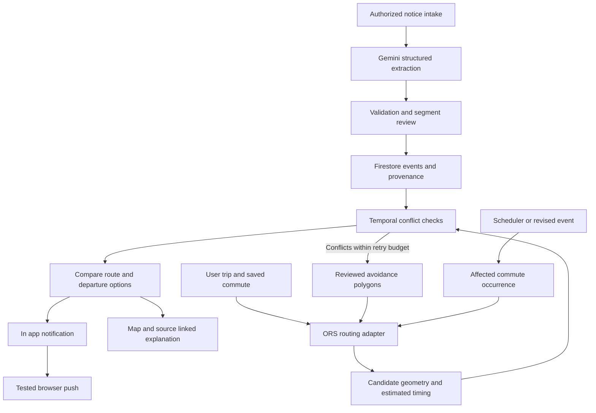

# Manzil Islamabad Closure Aware Commute Planner

> **Historical record — retained 18 October 2026.** This may contain superseded requirements, UI, activation state or release evidence. It is not a current instruction/runbook. Use the [documentation index](../../README.md) and [current status](../../IMPLEMENTATION_STATUS.md).

Developer brief, feasibility research, and proposed implementation plan. Updated 14 October 2026, Asia/Karachi.

**Current decision:** the founder selected a fast, simple Safar-inspired 2D interface. [MANZIL_ARCHITECTURE.md](MANZIL_ARCHITECTURE.md) is now the canonical implementation plan: Leaflet + MapTiler Dataviz Light raster + hosted ORS, Google Cloud Gemini/event services, explicit Champ connector access/coverage, manual/agent scheduling, opt-in personal trip data and a reviewed learned-road roadmap. Retain the older comparisons below as research context.

Project and team name: **Manzil (منزل)**, destination. Team: two developers. Target: finish the usable prototype by 17 October, preferably earlier to leave time for UI polish. Google Cloud billing and hackathon credit availability are not yet confirmed; available working hours are not yet quantified. The circular Urdu calligraphy logo is saved in assets/brand/manzil-logo-v1.png, with its generation prompt and usage notes in assets/brand/README.md. This is a planning document; API calls, routing quality in Islamabad, and alert extraction have not yet been tested in an implementation.

## 1 Quick summary for the team

Build a web app that turns local traffic notices into advance advice for a person's scheduled commute. Start in Islamabad and use Champ Alerts as the first intended information source. A commuter should learn that an announced closure affects the time they will reach a road, see the supporting notice, and compare a detour with leaving earlier or later.

The selected deadline stack is **Leaflet + MapTiler Dataviz Light raster + hosted openrouteservice (ORS)**, with **Gemini, Cloud Run, and Firestore** for our original AI/event/planning backend. The OSM-derived basemap, Manzil event layer and provider routing graph are separate. ORS accepts avoidance polygons directly; it has no live traffic feed, so label its travel times as ordinary estimates. Google traffic is deferred. [ORS routing options](https://giscience.github.io/openrouteservice/api-reference/endpoints/directions/routing-options) · [ORS traffic guidance](https://ask.openrouteservice.org/t/isochrone-trafic-data/7875)

**Safar's web map uses Leaflet with CARTO Voyager raster tiles derived from OpenStreetMap.** We can obtain that basemap style independently and put our original closure and detour layers above it. Section 19 records the evidence, current service conditions, and the distinction between map appearance and routing. [Safar Islamabad map](https://www.safar.fyi/islamabad)

The [mapping and similar-product comparison](../../research/MAPPING_PROJECT_COMPARISON.md) adds CommuteScout, Waze's advance-event workflow, Ghostway, and other close precedents. Its earlier 3D alternatives remain research; the founder has selected 2D and the final architecture fixes one renderer and router.

**Rerouting is a required core feature.** The prototype must demonstrate a valid connected detour around a reviewed test closure when such a detour is available. Warnings and earlier departure are additional choices; they do not replace that acceptance check. When no route can be validated, the correct result is an explicit unavailable/inconclusive state.

### 1.1 Features to build first

1. **Plan a trip:** select origin, destination, date, and departure time within Islamabad.
2. **Save a commute:** store its usual departure time and repeat days, without requiring continuous GPS.
3. **Ingest an alert:** initially paste authorized text with the source and original publication time. Screenshot intake and automatic retrieval follow only if time/access permit.
4. **Use Gemini to extract an event:** affected road, landmarks, direction, time window, event type, and missing information.
5. **Review the event:** a developer/admin confirms the actual segment and time before it becomes an operational closure. Show ambiguous notices as uncertain.
6. **Display closures:** distinguish scheduled, reported active, expired, cancelled, and uncertain events. A timeline changes the selected planning time.
7. **Check the commute:** estimate when the vehicle reaches the affected stretch and check whether that traversal overlaps the closure.
8. **Generate and compare options:** request a closure-avoiding detour, revalidate the result, and also compare earlier departure or later departure/waiting at the origin. Show departure, arrival, driving time, and added waiting.
9. **Explain the result:** identify the notice, affected segment, expected crossing time, and why the proposed option is better.
10. **Deliver an alert:** an in-app notification is required; tested browser push on one target browser is a high-priority milestone for unattended advance warnings. If push is unavailable, disclose that the prototype's warnings require opening the app.

### 1.2 Entire feature inventory from the founder

All of these are retained. Their phase is a recommendation, not a rejection of the idea.

| Feature | Intended behavior | Proposed phase |
| --- | --- | --- |
| Islamabad first, extensible later | Focus initial data and validation on the city; use configurable cities and timezones. | Prototype |
| Champ Alerts integration | Interpret scheduled or current closure notices; connect other sources later. | Manual/authorized intake now; automatic feed conditional |
| Google Maps preference | Google display/traffic and via-waypoint rerouting are a researched alternative; the initial recommendation uses OSM/ORS. | Alternative stack, subject to its rerouting gate |
| Scheduled blockages | Represent protests, containers, accidents, maintenance, and announced VIP-related traffic restrictions as road events. | Prototype |
| Scheduled daily commutes | Save office, school, or other journeys and their usual times. | Prototype, one profile initially |
| Advance notification | Warn when a notice affects a future journey, before the user leaves. | In-app now; one tested push channel high priority |
| Detour routing | Generate and validate a connected route avoiding applicable reviewed closures. | Required prototype feature, bounded search |
| Leave earlier | Compare a permitted earlier departure and confirm the segment is cleared before closure. | Prototype |
| Wait instead of detouring | Compare departure after the expected reopening with detour arrival time. | Prototype for explicit end times |
| Crowdsourced reports | Let commuters report a blocked segment and supporting observations. | Phase 2 |
| Report verification | Combine independent evidence, source quality, recency, and review. | Phase 2; admin review now |
| Bus/metro disruptions | Show affected routes, stations, or service periods. | Phase 2; one clearly labelled demonstration optional |
| Safar or operator integration | Use authorized route, stop, schedule, and disruption data for public transport. | Phase 2, access dependent |
| Multimodal alternatives | Combine bus, walking, or another service when a transit connection is suspended. | Phase 3 |
| Personal GPS travel history | Opt-in history of routes, travel times, and recurring journeys. | Phase 3 |
| Personal path comparison | Compare observed journey durations and preferences over time. | Phase 3 |
| Learned local shortcuts | Identify repeatedly observed paths for review and possible addition to an independently controlled road graph. | Research roadmap |
| Camera/privacy routing | Explore camera exposure information and avoidance options inspired by DeFlock/FlockHopper. | Separate later feature |

### 1.3 What we should finish before polishing

The demo must complete this chain: input notice → live Gemini extraction → reviewed event → scheduled journey → detected conflict → generated, validated detour and departure-time comparison → visible notification. It should also handle a cancellation and an ambiguous notice correctly. Deployment must work before the last day.

The most valuable polish is clear controls, readable route comparisons, source citations, uncertainty labels, responsive layout, and loading/error feedback. Extra integrations should wait until the core chain works.

## 2 Product positioning and hackathon assessment

### 2.1 The defensible differentiator

Describe the product as **a commute planner that makes local closure announcements usable before a journey**. The distinctive work is converting English, Urdu, or Roman Urdu notices and local landmarks into reviewed, time-specific events tied to a person's intended trip.

Do not claim that Google only plans for the present. Google's Routes API supports future departure times and predicted traffic. Waze already offers trip suggestions, road-closure delay notifications, and advice on when to leave. The proposed advantage is timely interpretation of local notices that those services may not yet incorporate; we must establish that gap with examples rather than assume it. [Google traffic models](https://developers.google.com/maps/documentation/routes/traffic-model) · [Waze trip suggestions](https://support.google.com/waze/answer/9747181?hl=en)

Safar already provides ordinary local transit discovery. Our future transit differentiation would be disruption-aware alternatives and reliable source explanations, not simply displaying the same bus routes. [Safar](https://www.safar.fyi/)

### 2.2 Fit with the Cup

The best initial theme is **Sustainability & Social Impact**, framed around accessible travel planning, community resilience, and reduced wasted journeys. **Future of Work & Enterprise Productivity** is an alternative if the product primarily serves employees/employers and demonstrates avoided commute disruption. Choose one theme. The rubric is technical/GenAI 40%, impact 25%, innovation 25%, and UX 10%; it does not award points for service count. [Official Cup requirements and judging](https://aibuildercup.com/themes.html)

| Criterion | Current opportunity | Main evidence needed |
| --- | --- | --- |
| Technical merit | Strong if extraction, geometry review, traversal-time checks, and deployed routing work together. | Live pipeline plus tests showing it rejects invalid recommendations. |
| Impact | A clear local problem and recognizable commuter audience. | Small user interviews and a documented before/after planning task. |
| Innovation | Moderate until we establish the gap against existing planned-drive tools. | Notices interpreted before baseline routing reflects them; clear local-language/landmark value. |
| UX | Strong potential for a simple source-to-journey story. | A user can understand the affected road, time, and choice without explanation from the team. |

This is a credible entry with a constrained scope. A reliable probability of winning cannot be estimated from public winner profiles: competitor quality and judges' eventual scores are unknown. The full proposed roadmap is too large for the remaining build time. A working source-to-decision demonstration could be competitive; a map with red overlays and untested AI claims would be weak.

The Cup requires a fresh working deployed project, public GitHub, a video under three minutes, and a deck; use PDF and English submission materials. The current published submission date is 18 October, with no public cutoff timezone verified. Our 17 October target provides a buffer. The team's age/professional eligibility and completed registration still need confirmation. [Cup FAQ](https://aibuildercup.com/Faqs.html) · [Cup timeline](https://aibuildercup.com/)

Use libraries as disclosed dependencies and write the new extraction, review, temporal reasoning, and user workflow ourselves. An open-source license permitting a fork does not establish hackathon freshness eligibility. Avoid submitting a modified pre-existing whole application; preserve licenses and disclose dependencies. The terms also include a six-month exclusive-licensing right of first refusal, described in the earlier research brief. [Official terms](https://docs.google.com/document/d/e/2PACX-1vRm7ChZ6Ij9fG7uFDkxzUMpwgVeBmnQ6cMDnAIEEX84AiLBOOQ9cYbl3S5OzFBbcVb8TF55s-eVpiXb/pub)

## 3 Google Maps feasibility and architecture choice

### 3.1 Separate the four responsibilities

| Responsibility | Meaning | Proposed owner |
| --- | --- | --- |
| Map rendering | Draw streets, controls, routes, and notices. | Leaflet + permitted OSM tiles in React initially |
| Routing | Produce connected road-travel candidates and travel estimates. | Hosted ORS initially; provider adapter allows another coherent stack |
| Closure knowledge | Store notices, source evidence, reviewed segments, schedules, and corrections. | Our backend and Firestore |
| Decision logic | Evaluate candidate traversal times and recommend an option. | Our deterministic planner; Gemini explains validated results |

There is no need to build a worldwide basemap. Leaflet/MapLibre render existing maps; a routing provider calculates paths. For the Google alternative, its React wrapper exposes map components/overlays but cannot add unsupported functionality to Google's routing service. [Leaflet](https://github.com/Leaflet/Leaflet) · [React Google Maps](https://github.com/visgl/react-google-maps)

### 3.2 Supported and unsupported behavior

Our own GeoJSON lines/polygons and information windows can overlay Google Maps. These annotations are local to our application and do not publish closures into everyone's Google Maps. The Data layer is appropriate for reviewed events. [Data layer](https://developers.google.com/maps/documentation/javascript/datalayer)

The public route-modifier schema has broad avoidance options but no arbitrary excluded road IDs, polygons, or time-windowed customer closure input. This is an inference from the complete documented schema. Drawing a closed stretch does not cause Google's next route request to avoid it. [RouteModifiers](https://developers.google.com/maps/documentation/routes/reference/rest/v2/RouteModifiers)

Driving routes can use a future departure timestamp. Driving arrival-by planning needs our own bounded departure search because arrivalTime is transit-only. Route responses can contain alternatives, but they are not guaranteed and are not returned when intermediate waypoints are used. [Compute Routes reference](https://developers.google.com/maps/documentation/routes/reference/rest/v2/TopLevel/computeRoutes)

Google's country coverage table marks core map, geocoding, traffic, and driving support for Pakistan. It does not guarantee every Islamabad street/closure or establish complete local public-transit coverage. Real corridor queries are an early acceptance test. [Coverage](https://developers.google.com/maps/coverage)

### 3.3 Recommended prototype track

**Track B, recommended: Leaflet + OSM tiles + hosted ORS + our closure validator.** Request a baseline, detect timed conflicts, submit reviewed avoidance polygons, and revalidate each generated detour. This avoids both graph-import work and building a Google anchor-search system during the deadline. API-key access, local road quality, polygon geometry, account terms, and quotas still require an early test. Choose MapLibre instead of Leaflet if the teammate is already faster with it; do not build both renderers. [ORS routing options](https://giscience.github.io/openrouteservice/api-reference/endpoints/directions/routing-options)

**Track A, traffic-first alternative: Google Maps + road-aware via-waypoint candidates + our closure validator.** Google's pass-through guide explicitly supports shaping a route around a known hazard. Try available alternatives, then ordered reviewed detour anchors with via:true. Recheck every result because a waypoint can still produce a route through the blocked segment. Traffic-aware durations are its main benefit here, not the number of Google tools. [Pass-through waypoints](https://developers.google.com/maps/documentation/routes/pass-through)

If no candidate survives, show **“No verified alternative found for this time”** and compare earlier/later departures where feasible. Do not invent a route, silently remove a closure, or label the result globally optimal. Say **“best among the evaluated options.”** An unchanged route with a better departure time can still be a useful outcome.

**Controlled later mode: the OSM frontend + self-hosted GraphHopper.** Choose this when owning the routing graph, request capacity, offline server operation, or custom road updates is essential. Importing road data, hosting, profiles, and validation add work. Valhalla is an alternative for a teammate with existing experience. Google Gemini, Cloud Run, and Firestore remain substantial Google integration. Self-hosting is not an instant fallback after a failed API setup.

Use a route-provider interface so the app's event/commute logic is reusable. Do not implement both tracks for the submission.

### 3.4 Decision gate on the first build day

Budget approximately two working hours for a spike; this is an estimate, not a known setup duration.

1. Confirm ORS key/account limits, Cloud deployment access, and the usable Gemini endpoint/model. Maps billing is needed only if choosing the Google track.
2. Obtain routes for three local origin/destination pairs, keeping the journey time in our planner even where the provider has no predicted-traffic model.
3. Apply reviewed demo closures and demonstrate a connected detour, including one case where the baseline is blocked, plus useful departure-time advice.
4. Check the actual return geometry, opposite-direction handling, multiple closures, and segment timing assumptions with the team’s local knowledge.
5. Choose Track B if these tests work. Use Track A only if its waypoint search passes the same detour gate and traffic predictions are the priority. Self-host only within a strict early setup budget. Freeze the provider choice on Oct 14; do not begin a new regional router import late on Oct 16. Narrow coverage honestly if needed, while preserving actual rerouting in the supported area.

Start with map-click endpoints or a small permitted landmark list. Add a provider-compatible search service only after the trip workflow is usable; reserve Google Places autocomplete for the coherent Google alternative.

### 3.5 Provider terms and current API pitfalls

Under the standard non-EEA service terms, Google Routes results cannot be displayed on a non-Google map. The latitude/longitude caching allowance is limited; it does not permit indefinite storage of all route responses. Save user-entered commute parameters and our own events, and recompute provider routes as needed. Place IDs have separate storage allowances. [Service-specific terms](https://cloud.google.com/maps-platform/terms/maps-service-terms) · [Routes policies](https://developers.google.com/maps/documentation/routes/policies)

Do not assume a Google-basemap/competing-router hybrid is automatically covered. The general terms contain broader non-Google content restrictions; select a coherent Google or coherent OSM mapping/routing stack unless the actual contract is clarified. Do not scrape Google to assemble a road dataset. [General terms](https://cloud.google.com/maps-platform/terms)

Old tutorials using Google's DrawingManager are unsuitable: the Drawing Library became unavailable in current Maps JavaScript versions in May 2026. Use ordinary overlays with click-based review/editing, or evaluate a maintained drawing library. [Deprecations](https://developers.google.com/maps/deprecations)

## 4 Source access and transit data

### 4.1 Champ Alerts identity

The corrected source is **ChampAlertsOnTheGo / CAOTG**. Its first-party Linktree lists Islamabad/Rawalpindi traffic communities and a twin-cities public-bus community. Its WhatsApp channel identifies Shaheryar Hassan as administrator and links the social accounts. [Champ Linktree](https://linktr.ee/ChampAlertsOnTheGo) · [WhatsApp channel](https://www.whatsapp.com/channel/0029Va8PLrl7j6gBLA3Y5m3J/)

The linked X handle is **@shaheryarhassan**, not an assumed @ChampAlertsOnTheGo. [Linked X profile](https://x.com/shaheryarhassan)

Public web landing pages establish identity and community invitations, not an accessible alert-history API. No producer API or RSS feed was established. We have not contacted Champ, joined a group, or obtained integration permission. The platform's own authenticity claims are not independently measured reliability.

### 4.2 Intake strategy

| Intake method | Feasibility | Recommendation |
| --- | --- | --- |
| Authorized pasted text/screenshot | Immediate, independent of social API setup. | Required prototype adapter, clearly labelled manual intake. |
| Champ provides a direct feed/webhook | Best partner path, but no access agreement exists yet. | Future integration; producer can include publication time, revision, and event identifiers. |
| Official X API from confirmed account | Technically plausible with credentials and credit setup. | Conditional adapter, not the critical path. |
| Forwarded message to our WhatsApp Business number | Possible for messages sent to our connected business number. | Later adapter if setup is ready. |
| Read an arbitrary existing WhatsApp group/channel | No verified entitlement or API established here. | Do not promise or depend on this. |
| RSS | Simple only if the producer actually offers a feed. | Keep as an adapter interface; no feed URL invented. |

Current X pricing is pay-per-use, with the published Post-read rate $0.005. At that rate, 1,000 new Post resources cost $5 before other resource charges. Recent search covers seven days and can filter a source account. Use incremental retrieval/deduplication rather than broad city-wide searches. No X account/API access was tested. [X pricing](https://docs.x.com/x-api/getting-started/pricing) · [Search](https://docs.x.com/x-api/posts/search/introduction)

X content display, removals, redistribution, and standalone geographic-information use have policy constraints. The geographic-information rule does not specifically resolve extraction of road events from notice text. Preserve provenance and establish downstream permissions before publishing a reusable geospatial dataset/API. Use our own synthetic fixtures in the public code repository rather than committing copied social posts. [X developer policy](https://docs.x.com/developer-terms/policy)

Meta's webhook documentation concerns our subscribed WhatsApp Business Account/number. It does not establish access to arbitrary existing community groups or channel histories. A Groups API exists, but its eligibility/limitations were not fully verified in this research. Use an authorized inbound message or manual intake, not a presumed community-monitoring integration. [Meta webhook documentation](https://www.postman.com/meta/whatsapp-business-platform/folder/ozgs3jn/webhook-subscriptions)

### 4.3 Other credible sources

Islamabad Police's own media page identifies @ICT_Police and traffic broadcasts. Its advisories can corroborate notices, but no official live closure API/RSS was verified. [Police media page](https://www.islamabadpolice.gov.pk/media.php)

Keep the data model source-independent. Future adapters can support traffic police, CDA, road operators, event organizers, and community reports. Distinguish what each source actually announced from our inferred geography or timing.

### 4.4 Safar and public transport

Safar exposes routes, ordered stops, fares, and scheduled timings for Islamabad/Rawalpindi and other cities. Its own website distinguishes schedules from live vehicle tracking. Its store listing says it is independent of CDA/PMA. No verified public developer API, open repository, downloadable GTFS feed, or redistribution license was found; these may exist privately, but are not established integration assets. [Safar](https://www.safar.fyi/) · [App listing](https://play.google.com/store/apps/details?id=com.safar.fyi)

The web frontend's map stack has now been verified separately: Leaflet with React bindings and CARTO Voyager raster tiles. Its own journey-search endpoints are visible in client code, but that does not establish a supported third-party API or permission to reuse its transit dataset. See section 19. The Android map implementation and backend route engine remain unverified.

CDA publishes route/headway tables and timetable PDFs, including direction-specific schedules. Its Metro app advertises tracking/arrival features, but that does not grant access to its backend. Public real-time API/GTFS entitlement and an open timetable redistribution license were not established. [CDA transit](https://www.cda.gov.pk/cdaTransitMap) · [Metro app](https://play.google.com/store/apps/details?id=com.kentkart.cdamobile) · [CDA terms](https://www.cda.gov.pk/termsAndConditions)

A future transit planner needs authorized routes/stops, service calendars, schedules/headways, transfer rules, and disruption mappings. “A bus line is suspended” can suppress that service, but a partial diversion needs updated stop/trip data. A road closure does not necessarily suspend a dedicated metro corridor. GTFS-Realtime alerts provide passenger information; trip updates/cancellations encode changes to service. OpenTripPlanner can consume updates, but local usable feeds are a prerequisite. [OpenTripPlanner updaters](https://docs.opentripplanner.org/en/v2.4.0/UpdaterConfig/) · [GTFS trip updates](https://gtfs.org/documentation/realtime/feed-entities/trip-updates/)

For the hackathon, a small bus-disruption card is a stretch feature. A complete multimodal planner should follow the road prototype. Link to external transit information as a reference rather than presenting an unimplemented partner integration as live.

## 5 AI extraction and event reliability

### 5.1 What Gemini should do

Gemini interprets text/images, proposes structured event fields, recognizes supported aliases, and explains validated comparisons. Use structured outputs with a schema, then validate in application code. Schema-valid output does not establish that a road/time claim is true. No model fine-tuning is required by this plan. [Gemini structured outputs](https://ai.google.dev/gemini-api/docs/structured-output)

Provide publication time, source timezone, the original notice, and candidate roads/landmarks as context. Ask the model to preserve supporting excerpts and mark unresolved fields. Model selection remains configurable: use a currently supported stable Gemini model available to the project's account and verify latency/quality on our sample. Do not choose the largest model merely for presentation value.

The LLM must not invent coordinates, routes, reopening times, or official verification. It can select candidate IDs from a controlled gazetteer and propose a segment. Deterministic logic resolves dates, validates geometry, checks conflicts, and ranks options. Treat notice text as data; embedded instructions must not trigger tools or administrative actions.

### 5.2 Required extraction distinctions

| Problem in a notice | Required handling |
| --- | --- |
| “Kashmir Highway” | Resolve the supported Srinagar/Kashmir alias, then establish the stretch. |
| Road name without endpoints | Show corridor-level uncertainty and request review; do not block the entire highway. |
| “Toward Faizabad” | Preserve affected direction/carriageway. |
| “Today/tomorrow” | Resolve from original publication time in Asia/Karachi, not forwarding receipt time. |
| “4:30–6:30” without AM/PM | Use explicit context or review; do not silently guess. |
| Cross-midnight interval | Normalize end onto the next date when supported; validate chronology. |
| “May close” / “expected” | Mark anticipated or uncertain, distinct from a confirmed report. |
| Congestion rather than closure | Keep separate; do not make the road impassable. |
| Reopening/cancellation | Update/supersede the matching event and re-evaluate affected journeys. |
| No end time | Mark unknown; do not promise a reliable wait-until time. |
| Forwarded/stale alert | Retain original source/date; uncertain freshness requires review. |
| Multiple roads/events | Extract separate events with separate supporting evidence. |

CDA documentation uses “Srinagar (Kashmir) Highway,” supporting that alias. Urdu/Roman Urdu spellings and local nicknames should be editable and tested, not assumed complete. [CDA reference](https://www.cda.gov.pk/public/Assets/pdf/1699885359_5d97b215_9a53_44b9_9d8d_d31e55ff0d4d_.pdf)

### 5.3 Trust, geometry, and lifecycle

Use separate extraction confidence, location confidence, time confidence, and evidence status. A model-generated “0.95 confidence” is not a calibrated reliability score. Display reasons such as explicit endpoints, official source, reviewer approval, or missing date.

Suggested publication workflow: received → extracted → needs review → published as reported/scheduled → updated/cancelled/expired. A time window ending means the stated schedule has ended; it does not prove the road has reopened. Distinguish expected_end_at from confirmed_reopened_at and preserve any subsequent still-active report. Expiry describes the information/schedule, not clearance. Preserve corrections and an audit trail.

For crowd reports later, independence matters. Three copied messages are one underlying observation. Consider authenticated contributors, recency, corroborating sources, direction, and review. Do not automatically label a closure verified because an arbitrary count threshold was reached.

For geography, use a small versioned, independently permitted road-segment/landmark gazetteer for supported corridors. The reviewer selects those segments/endpoints and direction while viewing the map. Do not create the gazetteer by retaining Google route polylines/geocoder content or tracing roads from Google imagery. A buffer around a point can falsely capture adjacent roads, service lanes, overpasses, or opposite carriageways. Publish only the reviewed scope and keep uncertainty visible. [Google content restrictions](https://cloud.google.com/maps-platform/terms)

USDOT's open WZDx schema is a useful design reference: it distinguishes start/end times from whether those times/positions were verified. Borrow that distinction without claiming Pakistan notices follow the standard. [WZDx event fields](https://github.com/usdot-jpo-ode/wzdx/blob/develop/spec-content/objects/WorkZoneRoadEvent.md)

## 6 Temporal routing and option comparison

### 6.1 Correct conflict calculation

For each candidate, calculate predicted entry and exit times at the affected segment. With an event interval [start, end), a conservative overlap check is:

```text
spatial_match(candidate, reviewed_event)
AND predicted_entry < event_end
AND predicted_exit > event_start
```

Different event types may close only entry to a junction or prohibit traversing a full stretch; model that explicitly. A disclosed configurable margin can account for uncertain timing. It is a planning assumption, not an official guarantee.

Operationally, evaluate earliest estimated entry and latest estimated exit for each affected crossing, including a route that crosses the geometry more than once. Classify boundary-overlapping estimates as uncertain. Recommend leaving early only when the latest estimated exit precedes closure start; a point estimate alone is insufficient. A scheduled end supports a conditional plan assuming the announced reopening occurs, unless a still-active report supersedes it. A confirmed reopening resolves that uncertainty.

Handle an unknown end time before applying the interval predicate; a null end must not silently make a conflict disappear. For a fresh, reviewed ongoing closure, conservatively exclude the affected stretch within the evaluated journey horizon and show that reopening is unknown. If freshness or start time is unresolved, return an uncertainty warning rather than a verified clear route. Re-evaluate or review stale notices; neither expiry nor silence proves reopening.

Synthetic illustration: departure at 16:20, arrival at the affected stretch at 16:40, and closure beginning at 16:30 means the trip is affected even though it began earlier. An earlier departure is useful only if the vehicle clears the relevant stretch before the closure, allowing for the chosen margin.

### 6.2 Google segment ETA limitation

Google exposes traffic-aware route/leg durations, while individual driving steps expose staticDuration rather than exact traffic-adjusted arrival timestamps. A prototype may distribute a leg's predicted duration across steps in proportion to static step durations and interpolate within a step. This is our approximation and must be labelled as an estimate with uncertainty, not exact live segment timing. Missing duration fields need a fallback or an inconclusive result. [Routes response schema](https://developers.google.com/maps/documentation/routes/reference/rest/v2/TopLevel/computeRoutes)

Request sufficient polyline detail. Test intersection with the entire line segment, not only sampled vertices. GeoJSON uses [longitude, latitude]; Routes API REST latLng uses latitude/longitude; Maps JavaScript LatLngLiteral uses lat/lng, and LatLng instances expose lat()/lng(). Keep conversion at adapter boundaries. Two-dimensional intersection cannot by itself establish a conflict between a flyover and the road below; direction/segment review is essential. [Maps JavaScript coordinates](https://developers.google.com/maps/documentation/javascript/reference/coordinates)

### 6.3 Bounded prototype search

1. Resolve notices into reviewed events for the full supported city and permitted departure/arrival horizon. In a small prototype this avoids missing events encountered only by a detour or delayed departure; a larger system must refresh event bounds/time for each candidate.
2. Request baseline/available alternatives for the selected departure. ORS supplies ordinary estimates; Google's alternative track can supply predicted traffic-aware durations.
3. Normalize provider geometry/timing into our candidate format.
4. Check all reviewed events against each candidate's traversal intervals.
5. In Track B, regenerate with avoidance polygons for detected conflicts and validate again. In Track A, try a small number of reviewed detour-waypoint requests and validate again.
6. Evaluate a few permitted earlier/later departure times; recompute routes and conflicts.
7. Compare acceptable choices and explain the best evaluated option.
8. If nothing is verified, return a clear inconclusive result with relevant source notices.

For an open router, request-level closure polygons can remove roads for a candidate query. They do not magically attach start/end schedules. Generate candidates under selected exclusions, simulate their traversal, and recheck every event; expand exclusions for newly encountered conflicts with bounded iterations. A whole-query exclusion can be conservative and miss a route that becomes usable later. Declare this limitation rather than claiming exact optimal temporal routing.

### 6.4 Wait or detour

Compare clock arrival times, not only driving durations. Show waiting at origin, departure time, expected arrival, distance, conflict status, and whether an arrival deadline is met. If normal driving takes 20 minutes but requires a 25-minute wait, compare 45 minutes until arrival with a 35-minute detour. These numbers are illustrative.

Do not infer roadside waiting spots. Waiting should be offered at the origin in the prototype. Unknown reopening does not support a specific wait-until time. Advice based on an expected end must say “assuming the announced reopening occurs” and be rechecked before departure; a still-active report overrides the expired schedule. Search only within the user's allowed departure flexibility; an employee may not be able to leave early.

An exact later engine would evaluate directed-edge costs using accumulated arrival time, with explicit waiting rules and FIFO assumptions. Ordinary static Dijkstra, or filtering closures only at trip departure, is insufficient. This is a roadmap investment, not a requirement for the bounded prototype.

### 6.5 Stable meanings in the UI

“No reported conflict” means none of our reviewed, available notices conflict with this candidate. It does not mean every road is open. “Reported closure” names the source. “Verified by reviewer” describes our review, not official police confirmation. “No verified alternative” acknowledges candidate/data limitations. Keep these meanings consistent in notifications and the demo.

## 7 Proposed implementation and contracts

### 7.1 Minimal stack

Choose this as the starting proposal, adapting only if either developer already has a much faster familiar stack.

| Component | Proposed choice | Purpose |
| --- | --- | --- |
| Web client | React + TypeScript + Vite | Trip form, map, timeline, event review, option comparison. |
| Maps | Leaflet + permitted OSM tiles | Map and original closure overlays; MapLibre only if already familiar. |
| Routing | Hosted openrouteservice | Baseline plus request-specific avoidance polygons; independent temporal validation. |
| API | Node/TypeScript service | Intake, Gemini calls, provider routing, temporal planner. |
| AI | Gemini through an available Google endpoint | Structured extraction and grounded explanation. |
| Hosting | Cloud Run | Deploy the working API and optionally serve the built web client. |
| Data | Firestore | Our sources, events, commutes, review history, notification records. |
| Geometry | Turf | Line/polygon checks and buffers around reviewed geometry. |
| Authentication | Minimal Firebase Auth/admin role if needed | Protect review/publish actions; keep demo access simple. |
| Scheduled evaluation | One Cloud Scheduler job + event-driven checks | Evaluate upcoming saved journeys and event changes. |
| Push | Firebase Cloud Messaging, high priority | Test unattended warnings on one supported browser; disclose limitations if unavailable. |

Do not add BigQuery, Pub/Sub, an agent framework, or model training solely to increase the Google-service count. They may become useful after scale/data requirements exist. Serverless processing should be stateless; schedules and event history live in persistent storage.



### 7.2 Event record

Proposed fields, not a provider schema:

```text
event_id, revision, city_id, event_type
source_id, source_url, source_item_id
original_published_at, received_at, original_language
original_notice_reference, supporting_excerpts
road_alias, candidate_segment_ids, reviewed_segment_ids
direction, reviewed_geometry, geometry_provenance
timezone, start_at, expected_end_at, confirmed_reopened_at, end_is_unknown
start_time_verified, end_time_verified, location_verified
evidence_status, extraction_notes, unresolved_fields
publication_status, reviewer_id, reviewed_at
supersedes_event_id, cancellation_reference
```

Store original content only with appropriate permission/access controls; public fixtures should be our own. Keep timestamps normalized to UTC and retain Asia/Karachi/local wording for explanation. Do not treat received_at as original publication time.

### 7.3 Commute and plan result

```text
Commute:
  commute_id, user_id, label, city_id
  user_entered_origin, user_entered_destination
  usual_departure_local, repeat_days, timezone
  earliest_allowed_departure, latest_allowed_departure
  optional_arrival_deadline, travel_mode, alert_preferences

Plan result:
  selected_departure, provider, generated_at, expires_at
  evaluated_options, conflict_event_ids, unresolved_event_ids
  recommendation_type, uncertainty_reasons
  source_references, request_usage_count
```

Provider route geometry/instructions must follow that provider's retention/display rules. Do not assume the plan-result record grants permission to store complete Google responses indefinitely. Store the original user inputs and our event/review data separately.

### 7.4 API surface

| Proposed endpoint | Purpose |
| --- | --- |
| POST /api/notices | Accept original text/image, publication time, and source reference. |
| POST /api/notices/:id/extract | Request/validate Gemini extraction; return proposed events. |
| PATCH /api/events/:id | Review geometry/time or apply a correction, with revision checks. |
| POST /api/events/:id/publish | Publish only an authorized, validated event. |
| GET /api/events | Read events for supported bounds and journey horizon. |
| POST /api/plans | Compare candidates and departure options. |
| POST /api/commutes | Save a schedule/preferences. |
| GET /api/notifications | Show journey impacts and subsequent corrections. |
| POST /api/jobs/evaluate | Authenticated internal scheduler entry point. |

Use idempotency/deduplication for notice intake and notification generation. An update key such as commute + occurrence date + event revision prevents repeated identical notifications. Reject stale reviewer writes. The internal scheduler and event publication endpoints require authorization.

### 7.5 Web notifications and GPS

An in-app warning can work immediately, but is visible only when the app is opened. Reliable advance checks must run on the backend; a timer in a browser tab is not a scheduling service. A new commute occurrence, changed departure, or revised event must obtain fresh provider candidates/timing before conflict checks. Preserve notification summaries and event/occurrence references rather than reusing expired provider routes. Web FCM uses a service worker for background notification handling, subject to browser support, permission, and user/device settings. Test on the actual demo browser and preserve the in-app fallback; backend scheduling alone does not deliver a closed-app warning. [FCM web messages](https://firebase.google.com/docs/cloud-messaging/web/receive-messages)

Current-location selection can use browser geolocation with permission and HTTPS. It is optional; users must be able to enter/select locations without it. A web page must not be sold as an always-on background GPS tracker. Continuous history would need explicit opt-in, retention/deletion controls, battery/background feasibility tests, and likely a later mobile design. [Geolocation API](https://developer.mozilla.org/en-US/docs/Web/API/Geolocation_API)

Never show private home/work coordinates or GPS traces in the public repository, logs, or demo recording. Server credentials stay on the backend; the browser Maps key should have API/referrer restrictions. Use separate credentials where restriction models differ.

## 8 Open source options and what to reuse

Integration burden below is our estimate. Licenses were checked in first-party repositories; verify the pinned versions and included dependencies during implementation. Map software, map data, and hosted tile services have separate licenses/terms.

| Project | License | Relevant capability | Fit for this build |
| --- | --- | --- | --- |
| [React Google Maps](https://github.com/visgl/react-google-maps) | [MIT](https://github.com/visgl/react-google-maps/blob/main/LICENSE.md) | React components/hooks and geometry overlays. | Use for Track A; low setup burden. |
| [Turf](https://github.com/Turfjs/turf) | [MIT](https://raw.githubusercontent.com/Turfjs/turf/master/LICENSE) | Buffers and geometry intersection. | Useful in either track; does not replace road routing. |
| [GraphHopper](https://github.com/graphhopper/graphhopper) | [Apache-2.0](https://github.com/graphhopper/graphhopper/blob/master/LICENSE.txt) | OSM road routing, custom areas/costs, alternatives. | Controlled self-hosted mode; medium regional import/hosting work. |
| [Valhalla](https://github.com/valhalla/valhalla) | [MIT](https://raw.githubusercontent.com/valhalla/valhalla/master/COPYING) | Road routing, exclusion geometry, time-related requests. | Good alternative if a ready deployment exists; medium/high burden. |
| [MapLibre GL JS](https://github.com/maplibre/maplibre-gl-js) | [BSD-3-Clause](https://raw.githubusercontent.com/maplibre/maplibre-gl-js/main/LICENSE.txt) | Interactive vector map and custom GeoJSON rendering. | Choose for Track B if familiar; tiles/styles must be supplied. |
| [Leaflet](https://github.com/Leaflet/Leaflet) | [BSD-2-Clause](https://raw.githubusercontent.com/Leaflet/Leaflet/main/LICENSE) | Simple 2D map, polylines, markers, popups. | Track B alternative to MapLibre; do not implement both. |
| [OSRM](https://github.com/Project-OSRM/osrm-backend) | [BSD-2-Clause](https://raw.githubusercontent.com/Project-OSRM/osrm-backend/master/LICENSE.TXT) | Fast road routing with prepared datasets. | Lower fit for frequently changing request-specific closures. |
| [OSMnx](https://github.com/gboeing/osmnx) / [NetworkX](https://github.com/networkx/networkx) | [MIT](https://raw.githubusercontent.com/gboeing/osmnx/main/LICENSE.txt) / [BSD-3-Clause](https://raw.githubusercontent.com/networkx/networkx/main/LICENSE.txt) | Python road graph extraction and algorithm experiments. | Research/validation alternative; navigation restrictions need additional work. |
| [pgRouting](https://github.com/pgRouting/pgrouting) | [GPL-2.0-or-later with component exceptions](https://raw.githubusercontent.com/pgRouting/pgrouting/main/LICENSE) | Routing over PostgreSQL/PostGIS road topology. | Later if already investing in a geospatial database; high setup. |
| [OpenTripPlanner](https://github.com/opentripplanner/OpenTripPlanner) | [LGPL-3.0-or-later](https://raw.githubusercontent.com/opentripplanner/OpenTripPlanner/dev-2.x/LICENSE) | Multimodal planning and transit feed updates. | Roadmap; needs usable local schedules/updates. |
| [DeFlock map](https://github.com/FoggedLens/deflockhopper_maps) | [MIT](https://raw.githubusercontent.com/FoggedLens/deflockhopper_maps/master/LICENSE) | Camera-report map interface and provenance patterns. | Study later; do not adopt the whole existing app. |
| [USDOT WZDx](https://github.com/usdot-jpo-ode/wzdx) | [CC0](https://github.com/usdot-jpo-ode/wzdx/blob/develop/LICENSE) | Event geometry/time/verification schema reference. | Borrow distinctions; do not implement the entire standard now. |
| [openrouteservice backend](https://github.com/GIScience/openrouteservice) | [GPL-3.0 root license with component-specific licensing](https://github.com/GIScience/openrouteservice/blob/main/LICENSE) | Native avoid-area directions; hosted service avoids importing our own graph. | Recommended hosted API dependency; self-hosting is a separate licensing/operations choice. |
| [ORS map client](https://github.com/GIScience/ors-map-client) | [Apache-2.0](https://github.com/GIScience/ors-map-client/blob/main/LICENSE) | Real Leaflet-based routing and avoidance UI. | Study interactions; implement our own focused React app. |

GraphHopper custom models accept GeoJSON areas and can set priority to zero for roads in an area, using compatible flexible routing settings such as ch.disable. This avoids those roads for that query; scheduled start/end semantics remain our planner's responsibility. Check the chosen release's custom-model/profile support before implementation. [Custom models](https://github.com/graphhopper/graphhopper/blob/master/docs/core/custom-models.md)

Valhalla documents exclude_locations and exclude_polygons, as well as date_time routing. An exclusion polygon alone does not encode the event's start and end. Validate returns against the temporal planner rather than equating request departure time with closure correctness. [Valhalla API](https://github.com/valhalla/valhalla/blob/master/docs/docs/api/route/api-reference.md)

OSRM's exclusions concern configured classes; arbitrary speed changes involve customization/contracting and dataset operations. It is less convenient for per-user changing closure scenarios. [OSRM traffic](https://github.com/Project-OSRM/osrm-backend/wiki/Traffic)

OSMnx's estimated travel times are free-flow approximations, not live congestion. NetworkX's ordinary edge weight callback does not receive accumulated arrival time, so a static callback is not an exact temporal planner. Research graphs need valid access/turn handling before navigation claims. [OSMnx](https://osmnx.readthedocs.io/en/stable/user-reference.html) · [NetworkX Dijkstra](https://networkx.org/documentation/stable/reference/algorithms/generated/networkx.algorithms.shortest_paths.weighted.dijkstra_path.html)

For Track B, OSM data is ODbL and requires attribution plus applicable database obligations; library licenses do not cover the data. OSM's public tile service has its own capacity/usage policy and is not an unrestricted production tile backend. Select permitted tiles or a suitable provider and maintain attribution. [OSM copyright](https://www.openstreetmap.org/copyright) · [Tile policy](https://operations.osmfoundation.org/policies/tiles/)

## 9 Costs and controls

### 9.1 Google Maps

Published global pay-as-you-go prices checked 14 October 2026; first paid tier in USD per 1,000 billable events:

| SKU | Monthly free cap | First paid tier |
| --- | ---: | ---: |
| Dynamic Maps | 10,000 map loads | $7 |
| Compute Routes Essentials | 10,000 requests | $5 |
| Compute Routes Pro | 5,000 requests | $10 |
| Geocoding | 10,000 requests | $5 |
| Autocomplete Requests | 10,000 requests | $2.83 |
| Place Details Essentials | 10,000 requests | $5 |

Traffic-aware route requests trigger Pro. Caps apply separately by SKU and usage is shared across projects on a billing account. Autocomplete sessions have additional charging rules. Billing is required even for usage within the free caps. The former $200 monthly credit was replaced by SKU-specific free usage in March 2025. [Pricing list](https://developers.google.com/maps/billing-and-pricing/pricing) · [Routes billing](https://developers.google.com/maps/documentation/routes/usage-and-billing) · [Pricing FAQ](https://developers.google.com/maps/billing-and-pricing/faq)

Illustrative demo budget: 200 map loads and 400 Pro route requests would fit the listed Maps caps if the account has no other usage consuming them. This is not a forecast or a guarantee of a free overall application. A request that returns alternatives is one route request; trying more departure times/waypoints creates more requests.

A larger illustration: 12,000 map loads yield $14 above the free cap; 6,000 Pro requests yield $10 above that cap. Combined $24 excludes other APIs, taxes, hosting, and AI. Recalculate if actual request features change the SKU.

Set small API quotas, request-count limits, a per-plan candidate budget, and rate limits on the public backend. Budget alerts notify rather than cap spending. Restrict browser keys by referrer/API and keep server credentials out of the client. Do not query every saved commute every minute. [Cost management](https://developers.google.com/maps/billing-and-pricing/manage-costs) · [API security](https://developers.google.com/maps/api-security-best-practices)

### 9.2 Cloud, AI, and source access

Cloud Run has a request-based free allowance, but CPU/memory duration, region, outbound transfer, builds, and associated services influence total costs. An always-running imported router has a different cost profile from the stateless prototype API. [Cloud Run pricing](https://cloud.google.com/run/pricing)

Firestore's free database quota includes 1 GiB, 50,000 reads/day, and 20,000 writes/day. Avoid frequent full-collection listeners or rewriting all journeys for every notice. [Firestore pricing](https://firebase.google.com/docs/firestore/pricing)

Cloud Scheduler provides three free jobs per billing account; additional jobs are $0.10 per job per month. Use a shared evaluation job rather than one job per commute. Executions can still create API/compute costs. [Scheduler pricing](https://cloud.google.com/scheduler/pricing)

Gemini cost depends on the actual endpoint/model, input images/tokens, output, and account entitlement. Measure a sample before promising a total. Track source retrieval, Maps requests, Gemini tokens, storage, and hosting separately. Hackathon credits are unknown; inspect the registered dashboard and confirm whether any award applies to Maps as well as Cloud. X charges are separate.

The [Google integration and first-month cost plan](../../research/MAPPING_PROJECT_COMPARISON.md#11-google-integrations-and-first-month-cost-plan) lists current service allowances and the meaningful minimum stack. The standard eligible $300 Cloud trial can cover Maps, but cannot pay Gemini Developer API/AI Studio charges; hackathon promotional credits remain offer-specific. Keep endpoint/tier and shared-account usage explicit.

## 10 UX plan and useful additions

### 10.1 Four views

1. **Plan:** origin, destination, departure date/time, optional permitted flexibility, and route results.
2. **My commute:** saved repeat days and upcoming impacts; no GPS history required.
3. **Alerts:** original source, publication time, affected geography, effective period, evidence status, and last update.
4. **Review:** extracted fields beside the notice, candidate segment/direction, unresolved fields, and publish/correct/cancel actions.

On desktop, use a map with a results panel and time control. On mobile, use a compact map and readable result sheet. Date/time are explicit, with Asia/Karachi shown. Keep the alert and journey result connected so users can inspect the reason for advice. Debounce time-slider changes or require “Recalculate”; moving the slider must not fire a paid routing request for every intermediate value.

Use labels and patterns/icons in addition to color, keyboard-accessible controls, text equivalents for map status, and a visible list of affected segments. Give feedback during extraction and route requests, and do not make an error look like an empty open-road result. These interaction choices apply UI/UX guidance to the planning experience.

### 10.2 Suggested additions ranked by value

| Suggestion | Value | Priority |
| --- | --- | --- |
| Alert expiry/cancellation and last-checked time | Prevent stale closures from misleading commuters. | Required reliability work |
| Source-linked explanation | Makes each recommendation inspectable. | Required |
| Time slider with a before/after result | Communicates the central scheduled-closure idea quickly. | High-value demo |
| Arrival deadline and departure flexibility | Makes wait/early-leave advice useful to real schedules. | High; simple bounded version |
| Urdu/Roman Urdu extraction checks | Strengthens local usefulness and AI differentiation. | High; limited tested sample |
| Share a sanitized trip result | Useful for colleagues/family without exposing exact private endpoints. | Stretch |
| Correction/report button | Builds a path for improving data without an entire crowd platform. | Stretch |
| Per-user alert lead time | Allows a warning at a useful time before the journey. | Stretch |
| Operator/admin feed portal | Easier authorized inputs and revisions from partners. | Phase 2 |
| Employer/school travel dashboard | Possible focused adoption channel after validating commuter value. | Later pilot |

### 10.3 GPS paths and privacy camera roadmap

Repeated GPS traces can suggest a missing path, but do not establish public access, vehicle legality, one-way direction, surface quality, or safety. Candidate paths need review and lawful data provenance before routing. Google's Roads API snaps points to existing roads; it is not a publishing interface for adding discovered roads. An independently controlled OSM-derived graph is the relevant future architecture. [Snap to Roads](https://developers.google.com/maps/documentation/roads/snap)

The related projects are **DeFlock** and **FlockHopper**. DeFlock maps/reports ALPR locations; FlockHopper provides camera-avoidance comparison. Their own coverage has limitations for unmapped/mobile cameras, and Islamabad coverage was not established. This cannot promise an undetected journey. The camera feature adds a different product purpose, dataset, and routing objective, so defer it. [DeFlock](https://github.com/FoggedLens/deflock) · [FlockHopper](https://dontgetflocked.com/) · [Integration assessment](https://github.com/flockhopperdev/FlockHopper/blob/main/API_ASSESSMENT.md)

## 11 Two developer plan through October 17

Estimates assume sustained availability, which has not been quantified. If time is tighter, narrow corridors, eliminate optional search/screenshot intake, and preserve the core pipeline, one tested notification channel, and submission artifacts.

| Date | Developer A | Developer B | Shared completion check |
| --- | --- | --- | --- |
| Oct 14 | Cloud/API access spike; event schema; Gemini text extraction; deployment skeleton. | React trip form/map; endpoint selection; event review wireframe. | Freeze one provider stack; deploy one supported corridor, reviewed segment, and useful route/time result. |
| Oct 15 | Event validation/revisions; candidate conflict checks; departure comparisons. | Closure/time UI; review publishing; comparison cards; saved commute. | Authorized/synthetic notice changes a live planned trip and yields useful advice. |
| Oct 16 | Meaningful test cases; timing/geometry fixes; one tested push channel and request controls. | Responsive UI; source/uncertainty states; user task feedback. | Core feature complete; background warning tested; live demo stable; deck/video drafts underway. |
| Oct 17 | Final regression, deployment/config checks, README and architecture. | UI polish, final PDF deck and under-three-minute video. | Verify public links and submit; avoid new major features. |

Agree shared TypeScript contracts early. Work in separate components/modules and review integration changes. Deploy every day; do not reserve Cloud deployment for Oct 17. Finish the core by Oct 16 so Oct 17 serves the requested polish/submission goal.

### 11.1 Cut order if behind

Cut camera routing, GPS history/learned roads, full public transit, crowdsourced consensus, automatic social retrieval, screenshot intake, continuous slider recomputation, and optional Places search in that order. Keep live text extraction, reviewed event geometry/time, a deployed route/departure comparison, clear sources, and a reliable demo. Prioritize one tested push channel for the advance-warning goal. If it fails, explicitly narrow the prototype to warnings visible when the app is opened. Manual ingestion is acceptable only when disclosed; a mocked extraction pipeline is not equivalent to the live feature.

### 11.2 Acceptance checks

| Check | Required result |
| --- | --- |
| Notice with explicit segment/direction/time | Proposed fields match the notice; reviewer can publish it. |
| Same corridor but other direction | Does not produce a confident false closure on the unaffected carriageway. |
| Departure before closure, traversal during it | Detects the conflict. |
| Traversal clears the stretch before closure | Does not reject it without a disclosed uncertainty reason. |
| Cross-midnight schedule | Normalizes both dates correctly. |
| Missing date/endpoints/end time | Shows unresolved fields and limits operational use. |
| Revised/cancelled notice | Updates the event and affected commute notification once. |
| Announced end passes but a new report says still closed | Does not clear the road or recommend waiting from the old end time. |
| Timing estimate overlaps closure boundary | Shows uncertainty; early departure needs latest estimated exit before closure. |
| Detour or later departure reaches a different event | Refreshes event scope and catches that conflict too. |
| Scheduled recheck | Fetches fresh candidates/timing before generating the occurrence's notification. |
| Route crosses between sampled vertices | Geometry check still detects the intersection. |
| Parallel/flyover geometry | Review/data can distinguish it; otherwise report uncertainty. |
| Every returned candidate conflicts | No invented path; show inconclusive result and feasible time options. |
| Wait is faster in clock arrival than detour | Comparison includes waiting at origin and recalculates the later trip. |
| Saved repeat-day commute | Evaluates the correct future occurrence in Asia/Karachi. |
| Provider/LLM failure or quota hit | Useful error state; existing evidence remains inspectable. |
| Browser denies location/push | Manual location and in-app alert still work. |
| Background push on the target browser | Tested warning arrives with the app out of focus/closed where supported; limitation is disclosed otherwise. |
| Public submission | Live app, repo, video, and PDF open under intended access settings. |

### 11.3 Evidence to collect

Start with five essential labelled notices covering a normal closure, ambiguity, direction, a cross-midnight period, and cancellation. Expand toward 20–30 authorized or original synthetic notices if time permits, including Urdu/Roman Urdu. Record per-field correctness and ambiguity detection; do not publish a single accuracy percentage without explaining the sample. Test several real local route scenarios with normal and affected times. Record failures, not only successes.

Ask a few commuters to plan one task in the app and compare it with manually reading notices. Measure completion time, errors, and whether the advice is understood. This supports usability, not broad adoption claims. Log extraction/plan latency and API usage. If historical replay is used, label it clearly as replay; future demo events must not appear to be actual current traffic restrictions.

### 11.4 Demo and deck

Use a synthetic or authorized notice with two landmarks, direction, and a date/time. Show the saved commute, the original route, live extraction, review, a time-specific conflict, and comparison of options. Then show cancellation or ambiguity handling. A source-to-decision story is stronger than a tour of unfinished menus.

Aim for about 170 seconds: problem 20; live core flow 90; timing/alternative result 25; Google architecture and measured evidence 20; limitations/roadmap 15. Export the deck as PDF with problem/user, solution, architecture, differentiator, evidence, and roadmap. The current Cup requires a working deployed URL, public repo, and video strictly under three minutes. [Submission FAQ](https://aibuildercup.com/Faqs.html)

## 12 Decisions and questions for the teammate

| Decision | Current proposal | Change it only when |
| --- | --- | --- |
| First user | Islamabad commuter with a recurring road journey. | A more specific accessible user group can be validated faster. |
| First source | Champ intended; authorized manual intake initially. | Reliable permitted automation is available. |
| Mapping/routing | Track B hosted ORS + OSM frontend, with an early rerouting gate. | Native detours/local data fail, or a tested Google track's traffic advantage outweighs extra search work. |
| Geo review | Human-confirmed supported segments for prototype. | Automated matching is proven against labelled cases. |
| Notification | In-app required; one tested push channel high priority. | Push setup fails, requiring explicit limits on unattended warnings. |
| Transit/GPS/camera | Roadmap. | Core and submission package are already complete with ample remaining time. |
| Scope expansion | Evaluate impact, engineering cost, and evidence value. | It strengthens the scored demo without threatening Oct 17 completion. |

Before implementation, confirm billing/credits, teammate strengths, available hours, two or three demo journeys, and one authorized representative Champ notice. Ask the organizer only where eligibility/freshness or conflicting roster rules actually affect the entry. Source partnerships and external messages have not been authorized or sent.

The next concrete milestone is a thin deployed source-to-trip flow. Once that works, refine reliability and the presentation before adding roadmap features.

## 13 Routing decision in depth

### 13.1 Recommendation and tradeoffs

For Manzil's two-person deadline, use **Leaflet + MapTiler Dataviz Light raster + hosted ORS**, with our own TypeScript backend calling ORS and Gemini. The founder selected simple 2D; use the canonical final architecture rather than reopening the earlier renderer comparison.

The reason to prefer ORS is its direct avoidance-polygon input. Google via routing is legitimate, but automatically discovering enough good anchor sequences for arbitrary closures is extra software/data work. Self-hosted GraphHopper gives more graph control, but imports and deployment are extra operations work. This ranking is our engineering judgment, conditional on a working ORS key and Islamabad smoke tests.

| Manzil need | Google via routing | Hosted ORS | Self-hosted GraphHopper |
| --- | --- | --- | --- |
| Generate a custom-closure detour | Shape candidates with reviewed road anchors, then reject conflicts. | Supply avoidance polygons, then reject conflicts. | Custom-model areas/exclusions, then reject conflicts. |
| Local live/predicted traffic | Google traffic-aware durations. | No public live traffic feed. | Requires independently supplied traffic data. |
| Scheduled closure windows | Our traversal-time logic. | Our traversal-time logic. | Our traversal-time logic. |
| Setup for the deadline | Billing/key plus an anchor-selection strategy. | Key, quotas, attribution, and local road-quality tests. | Regional import, Java/server, persistent graph, resource benchmarks. |
| Future reviewed road additions | No road-publication API in this stack. | Hosted graph is controlled by ORS. | We control source updates and reimports. |
| Request capacity | Paid/free SKU allowances and request budgets. | Hosted quotas and restrictions. | Our compute/memory/capacity. |
| Main limitation | Candidate-search completeness and provider content terms. | Traffic estimates, hosted limits, geometry/data quality. | Operating and updating the router. |

**Do not run two routing stacks in the initial app.** A provider adapter is enough to preserve flexibility. If real-time congestion turns out to be more important than the flexibility of closures, Google becomes a defensible first choice only after its waypoint search passes the same rerouting gate.

### 13.2 ORS account and avoidance limits

ORS accepts a GeoJSON Polygon/MultiPolygon in options.avoid_polygons. Public restrictions list avoid-area routes up to 150 km, polygon area up to 200 km² and height/width up to 20 km, and at most three alternatives. These are nominal limits, not proof of quality in Islamabad; a scattered union of closures may exceed the extent limit even when each individual segment is small. [Routing options](https://giscience.github.io/openrouteservice/api-reference/endpoints/directions/routing-options) · [Public restrictions](https://openrouteservice.org/restrictions/)

The inspected official staging plan and a recent forum question list Standard at 2,000 directions/day and 40/minute. The production plan page redirects to a dynamic account page that was not fully readable here. Treat these numbers as an indicative planning allowance and verify the actual account before implementation. The October 12 staff reply confirms Standard commercial use and notes CC BY-SA 4.0 licensing for results; it does not provide a legal interpretation of all data/privacy/license situations. Check the current full terms and required attribution. [Account plans](https://account.heigit.org/info/plans) · [Staff clarification](https://ask.openrouteservice.org/t/free-plan-in-an-app-with-a-paid-tier-license-cc-by-sa-4-0-personal-data-and-attribution-questions/8079)

Start with a shared cap of six ORS directions requests per plan, including failed requests, avoidance retries, and departure comparisons. This cap is our proposal and may be tuned after the rerouting gate; it would allow roughly 333 plans/day under a 2,000-request allowance if no other calls consume it. Parallel requests still count against the minute quota. Reuse identical normalized static requests within the same plan, while recalculating their traversal times for each departure. Enforce per-user/shared budgets and a request deadline in the backend.

ORS public traffic guidance explicitly says no live traffic data. The app can model our notices, but cannot claim an ORS duration includes current congestion. Store time_basis with each result: ordinary estimate, predicted traffic, or measured own observations if available later. [Traffic guidance](https://ask.openrouteservice.org/t/isochrone-trafic-data/7875)

### 13.3 Self-hosted GraphHopper mode

Use GraphHopper after a working hosted prototype, or earlier only if an experienced teammate can demonstrate the import/server within the setup budget. Pin the release/configuration: the 11.x README uses Java 17+ and provides the 11.1 server. Import a city-plus-detour-margin extract; preserve complete ways and relevant relations so boundary clipping does not manufacture disconnected routes. [11.x README](https://github.com/graphhopper/graphhopper/blob/11.x/README.md) · [Osmium extraction](https://docs.osmcode.org/osmium/latest/osmium-extract.html)

Separate import from serving, persist graph data, and measure peak memory, startup, request latency, and restart behavior. A downloaded country's file size is not the RAM requirement. No reliable Islamabad benchmark was established; a 4–8 GiB experiment is a starting budget, not a promise. Flexible routing can be more expensive than precomputed routes. [Deployment guidance](https://github.com/graphhopper/graphhopper/blob/11.x/docs/core/deploy.md)

GraphHopper's hosted Free tier is not the same as its self-hosted open-source engine. Current hosted pricing disables ch.disable=true on Free, while the documented request-customization example needs flexible routing. Free ordinary routing therefore does not establish usable arbitrary polygon exclusions. Basic starts at €69/month; verify actual key capabilities before paying. [Hosted pricing](https://www.graphhopper.com/pricing/) · [Custom-model example](https://github.com/graphhopper/graphhopper/blob/11.x/docs/core/custom-models.md)

No need to modify the router's Java internals now. Feed supported custom-model exclusions and let our planner handle schedules and post-validation. A server that works offline after import does not make the browser's tiles, search, or mobile navigation offline.

### 13.4 Other providers

Valhalla supports exclusion geometry and time-related routing, but requires a tile build and deployment; historical/live traffic additionally needs independently supplied data. Choose it if the teammate already has that infrastructure. [Valhalla API](https://valhalla.github.io/valhalla/api/route/api-reference/) · [Speed data](https://valhalla.github.io/valhalla/concepts/speeds/)

HERE's API has richer avoid-area/segment inputs, but its known issues allow avoidance violations and its routing coverage lists Pakistan in an Entry Map/non-navigable category. TomTom supports avoid-area rectangles and Pakistan routing, but its current coverage table does not list real-time traffic for Pakistan. Neither is a ready Islamabad upgrade just because the request schema looks attractive. [HERE avoidance](https://docs.here.com/routing/docs/routing-v8-avoid-area) · [HERE issues](https://docs.here.com/routing/docs/routing-v8-known-issues) · [HERE coverage](https://docs.here.com/routing/docs/routing-v8-non-navigable-countries) · [TomTom coverage](https://docs.tomtom.com/routing-api/documentation/tomtom-maps/v1/product-information/market-coverage)

## 14 The Google waypoint approach

### 14.1 What is supported

The founder's idea is a supported use of **via waypoints**. Google's guide describes preferred-road and known-hazard use cases. Via points are intermediate locations to pass through, rather than extra destinations where the journey stops. Use precise coordinates and fixed order for shaping. Up to 25 intermediates are documented; vias cannot be combined with waypoint-order optimization, and intermediates suppress alternative routes. Via points do not create extra legs. [Pass-through guide](https://developers.google.com/maps/documentation/routes/pass-through) · [Intermediate guide](https://developers.google.com/maps/documentation/routes/intermed_waypoints)

An anchor must be on a lawful, reachable bypass road. Do not set the intermediate point exactly at the blocked entry and force the driver toward it. Choose an upstream exit, appropriate points on the bypass, and a downstream rejoin beyond the affected area. Coordinates can snap to the wrong road, so placement and direction need testing.

```text
Baseline:     A -- upstream junction -- CLOSED STRETCH -- downstream junction -- D
Bypass:                         \-- C1 -- C2 -- C3 --/

Google request: A → via C1 → via C2 → via C3 → D
Manzil check: validate every returned segment and its estimated traversal time.
```

This sketch is conceptual and does not assert those junctions exist for any real closure.

### 14.2 Generate useful anchors

For a supported corridor, maintain a small original/local-surveyed or independently permitted list of valid detour roads and anchor sequences. Preserve one-way direction, accessible turns, separate carriageways, bridge connectivity, and vehicle profile. Prefer one to three meaningful anchors on bypass road stretches over a ring of random points around the blockage.

An OSM-derived graph can technically help propose anchors, but a generic coordinate input allowance does not settle every provider/data combination. Keep provenance and check the actual contract. Do not copy Google road/traffic content into a reusable OSM graph under an assumed permission.

Each candidate sequence requires a new complete route query at the selected departure time. Verify the returned path, not just whether the route visited the anchor. A path can reach an anchor through the closure or loop back through it. Deduplicate similar routes, reject unexplained loops/U-turns, and re-evaluate all events across the detour's extent and time horizon.

### 14.3 Bound the search

An illustrative Google cap is 12 route requests per interactive plan: one baseline/alternatives request, up to six anchor-sequence requests, two conflict refinements, two departure comparisons, and one final refresh. This is our proposed budget, not a platform limit. Tune it after measurement and enforce cancellation, request deadlines, and per-user/shared allowances.

At the listed Pro rate, 12 paid route requests cost about $0.12; 5,000 free requests cover roughly 416 plans at that maximum before other usage. Maps, AI, hosting, and taxes are additional. Requesting TRAFFIC_ON_POLYLINE triggers Enterprise rather than ordinary Pro traffic-aware duration; Enterprise has a smaller free cap and higher first-tier rate. Its traffic intervals are categorical, not exact edge speeds or traversal timestamps. Do not request this field merely to make the UI colorful. [SKU triggers](https://developers.google.com/maps/billing-and-pricing/sku-details) · [Pricing](https://developers.google.com/maps/billing-and-pricing/pricing)

Via waypoints improve shape constraints, not timing resolution. Do not estimate a candidate's prefix by independently requesting origin-to-closure unless that prefix matches the actual candidate: the provider may select a different path. Keep the segment ETA approximation in Section 6 explicit.

### 14.4 Navigation handoff

Google Maps URLs can send endpoints and some ordered waypoints, with platform-dependent limits, but do not carry Manzil's closure model or validated path. Handoff asks Google to calculate a new route. A Routes routeToken is for the Navigation SDK and is unsupported for via routes; it is not a consumer Maps URL route-locking mechanism. [Maps URLs](https://developers.google.com/maps/documentation/urls/get-started) · [Route token reference](https://developers.google.com/maps/documentation/routes/reference/rest/v2/TopLevel/computeRoutes)

For the prototype, the validated route in Manzil's web view is the product result. If offering “Open in Google Maps,” explain that the receiving app can change the route. GPX/export or turn-by-turn navigation is a separate integration, not proof that another app will obey our scheduled closures.

## 15 What related projects actually implement

The following observations come from public documentation/source inspection, not running production apps. Public repositories can differ from current deployed services. They are architecture references rather than ready-made Manzil codebases.

### 15.1 DeFlock and FlockHopper

The projects referred to as “Devlogger/Deflocker” appear to be **DeFlock** and its related routing product **FlockHopper**. The inspected FoggedLens/deflockhopper_maps source, described as DeFlock Maps provided by FlockHopper, uses MapLibre with Protomaps layers and its own tile/fonts/sprites infrastructure rather than Google Maps. The frontend calls a separate routing endpoint and receives normal/avoidance routes and comparison metrics. That inspected interface has no scheduled-event/departure fields; source inspection does not establish which version production runs. [Map component](https://github.com/FoggedLens/deflockhopper_maps/blob/master/src/components/map/MapLibreContainer.tsx) · [API client](https://github.com/FoggedLens/deflockhopper_maps/blob/master/src/services/apiClient.ts)

The older FlockHopper source follows a useful pattern: obtain a baseline, find relevant cameras near its geometry, request avoidance, recount exposure, and compare results. It also tries waypoint-based improvements. [Routing orchestrator](https://github.com/flockhopperdev/FlockHopper/blob/main/src/services/cameraAwareRouting.ts)

Its configuration calls one area a block zone but sets blockPriority to 0.0001 and penaltyPriority to 0.01. Those are heavy soft penalties, not hard exclusion. The provider service builds circular/directional zones, sends a GraphHopper custom model, and can fall back to graduated penalties or the baseline. Camera exposure minimization tolerates a tradeoff; an active closed road does not. Never import that fallback behavior into Manzil. [Configuration](https://github.com/flockhopperdev/FlockHopper/blob/main/src/services/routingConfig.ts) · [GraphHopper adapter](https://github.com/flockhopperdev/FlockHopper/blob/main/src/services/graphHopperService.ts)

Additional lessons from the inspected code:

- Its primary avoidance branch can log a detour-cap violation yet accept the candidate. Manzil must enforce constraints before displaying a recommendation.
- Endpoint-based obstacle bounds can miss obstacles on a detour. Query the actual candidate extent or the whole supported city.
- Geometry checks should inspect line segments and use appropriate metric/geodesic calculations.
- Cache keys must include event revision, journey occurrence, departure time, profile, and preferences. Discard stale route responses after any of those change.
- The camera direction value zero is valid; checking numeric direction by truthiness can misclassify it as absent.

[Spatial helpers](https://github.com/flockhopperdev/FlockHopper/blob/main/src/utils/geo.ts) · [Current route store](https://github.com/FoggedLens/deflockhopper_maps/blob/master/src/store/routeStore.ts)

Do not copy its older request schema/version assumptions. Current GraphHopper custom-model docs use a GeoJSON FeatureCollection for areas. Test against the pinned release. Camera-zone radii/cones are product tuning assumptions, not authoritative physical boundaries. Manzil's geometry should describe the actual reviewed road event.

### 15.2 openrouteservice social-report avoidance

ORS published a flood-routing example that converts social reports into buffered avoided areas and compares normal/avoidance routes. This is close prior art for the broad “social report becomes route exclusion” idea. Its data is historical flood-related/geolocated tweets, not Manzil's local-language announcement/time-review/recurring-commute workflow. The notebook contains old dependencies and assumptions; learn the pattern rather than copy its code or treat its social-source access as current. [ORS example](https://openrouteservice.org/example-avoid-flooded-areas-with-ors/)

ORS's inspected AvoidAreasEdgeFilter retrieves full edge geometry and checks polygon relationships to reject affected roads. Boundary touching/overlap, endpoint snapping, narrow carriageways, and grade separation still deserve test cases. [Edge filter](https://github.com/GIScience/openrouteservice/blob/main/ors-engine/src/main/java/org/heigit/ors/routing/graphhopper/extensions/edgefilters/AvoidAreasEdgeFilter.java)

### 15.3 BRouter

BRouter Web is a real draw-obstacle/request/display reference. Its server understands no-go points, polygons, and polylines, with hard avoidance or weighted penalties. The inspected request fields do not attach event schedules. Its web adapter warns that the used API is not a public integration contract, so do not depend on the demo server for Manzil. Driving profiles and local ETA quality would need evaluation. [BRouter Web](https://brouter.de/brouter-web/) · [Server parser](https://github.com/abrensch/brouter/blob/master/brouter-server/src/main/java/btools/server/request/ServerHandler.java) · [Web adapter](https://github.com/nrenner/brouter-web/blob/master/js/router/BRouter.js)

The engine and web client are MIT with additional third-party notices. Study the editable no-go geometry UX; do not use a straight-line option as a road-navigation fallback. [Engine license](https://github.com/abrensch/brouter/blob/master/LICENSE) · [Web license](https://github.com/nrenner/brouter-web/blob/master/LICENSE)

### 15.4 Organic Maps

Organic Maps already supports a temporal road-access pattern. Its road-access source evaluates conditions using cumulative arrival-related route weight and a confidence window; the official release archive reports road-closure time support in November 2025. It is therefore inaccurate to claim timed closure routing itself is a new invention. Its C++ mobile engine is not a ready web notice-ingestion backend for this deadline. [Road-access source](https://github.com/organicmaps/organicmaps/blob/master/libs/routing/road_access.cpp) · [Release archive](https://organicmaps.app/news/releases/)

### 15.5 The novelty claim we can defend

Manzil combines locally phrased notices, aliases/landmarks, original publication time, reviewed geometry/direction, planned closure schedules, saved journeys, and traceable advice. The difference is the **complete source-to-commute workflow**, not merely adding obstacle polygons, drawing an OSM map, or computing a detour.

To substantiate the claim, show several real or authorized local examples, a cancellation, ambiguity handling, and at least one baseline provider result changed by a notice. Do not claim to be first worldwide, guarantee traffic accuracy, or infer judges' preference for Google Maps itself.

## 16 Rerouting implementation specification

### 16.1 Shared provider contract

```text
route(request):
  origin, destination, travel_profile
  intended_departure, candidate_anchors (Google mode)
  excluded_reviewed_geometries (ORS/GraphHopper mode)
  request_deadline, event_revision_snapshot

candidate:
  geometry, distance_meters, estimated_duration_seconds
  step_or_edge_timing, time_basis, provider_warnings
  data_snapshot_or_generated_at

validate(candidate, occurrence, all_relevant_events):
  blocking_conflicts, boundary_uncertainties
  direction_or_geometry_uncertainties
  valid_for_recommendation, evidence_references
```

Keep internal coordinates consistently [longitude, latitude], units meters/seconds, and timestamps UTC plus the original local wording. Provider adapters convert explicitly. Do not accept a candidate from an outdated event snapshot; cancel or recompute when the user changes the trip/time.

For ORS, request sufficiently detailed GeoJSON geometry and instructions. Accumulate properties.segments[].steps[].duration and map each step's way_points interval to the geometry indices. Interpolate a crossing within that interval using metric distance. This is an ordinary timing approximation, not measured edge traffic. Missing/invalid step indices or durations require a disclosed estimate fallback or an inconclusive result. [Response types](https://giscience.github.io/openrouteservice/api-reference/endpoints/directions/requests-and-return-types) · [JSONStep fields](https://github.com/GIScience/openrouteservice/blob/main/ors-api/src/main/java/org/heigit/ors/api/responses/routing/json/JSONStep.java)

No blocking conflicts is necessary but insufficient for verified recommendation eligibility. Relevant timing-boundary, carriageway/direction, or grade-separation uncertainty must remain explicit and prevent confident clear-road advice. Suggested result reasons include validated, conditional_uncertain, provider_error, budget_exhausted, and no_valid_candidate_found. The last describes our search outcome, not proof that no connected path exists.

### 16.2 Planned closure regeneration

1. Obtain a baseline and available alternatives for the occurrence.
2. Evaluate earliest entry/latest exit at each affected segment crossing.
3. Preserve candidates without blocking conflicts and flag remaining uncertainty.
4. For conflicts, submit their reviewed exclusion polygons and regenerate.
5. Validate the whole new route against all events, including those outside the original route bounds.
6. Add newly encountered conflicts within that departure option and retry within the shared budget; stop on repeated geometry/no new exclusions or timeout.
7. Evaluate permitted earlier/later departures with a fresh exclusion set for each option and recompute timing. Otherwise a closure from the original departure can incorrectly exclude a road after reopening. Within one plan, identical static ORS requests can reuse candidate geometry; changed exclusions require another query.
8. Rank acceptable outcomes; publish only candidates that pass hard checks.

On budget exhaustion or no progress, preserve already validated options and state the search limit. If none passes, return the appropriate reason instead of an unsafe baseline. Failed requests and retries consume the same cap as successful queries.

The exclusions remain fixed per query, so this bounded method can be conservative. It may miss a path usable only after reopening or a globally better combination of waits. Record that limitation. A future exact temporal graph engine must model edge-entry time, waiting permissions, turn/access restrictions, and its timing assumptions explicitly.

ORS avoidance polygons have no direction field: they exclude intersecting road geometry in either direction. Our event direction metadata does not change that API behavior. Use separately mapped carriageway geometry when possible; otherwise mark conservative exclusion or uncertainty. A single bidirectional road centerline cannot support precise one-direction exclusion through polygons alone.

### 16.3 Hard and soft constraints

| Input | Planner behavior |
| --- | --- |
| Reviewed active closure overlapping traversal | Hard reject, regardless of detour cost. |
| Unconfirmed possible closure | Warn/review; user policy can request conservative avoidance. |
| Congestion notice without measured speed | Explain reported delay; do not invent a speed or precise penalty. |
| Arrival deadline | Report whether an evaluated option meets it; never hide failure. |
| Maximum detour preference | Enforce or ask/show a labelled exception; never merely log it. |
| No acceptable connected route | Unavailable/inconclusive, with source evidence and feasible time choices. |
| Provider error | Error/retry state; do not quietly return the blocked baseline. |

Route constraints must outrank an AI-written explanation or optimization score. Gemini receives only validated option facts for its final explanation. Unit tests should target these invariants rather than mirror implementation details.

### 16.4 Minimum rerouting gate

Before polishing, verify three realistic local journeys, a closure covering a baseline segment with an available bypass, a one-direction event, two interacting closures, crossing after a scheduled start, expected end versus still-active update, and no feasible route. Label test closures synthetic unless they are current verified notices. Save test inputs and expected outcomes, not copied provider data contrary to its terms.

Measure candidate count, failed attempts, latency, request usage, and detour validity. Accept the provider only if it can generate and validate useful detours in the supported corridors. Publish the supported scope honestly. A failure to reroute is a reason to fix the engine/search or narrow coverage, not quietly convert the project into a warning-only app.

## 17 Additional features suggested for Manzil

These are additions to the founder's retained inventory. Most reuse the same reviewed-event and saved-journey foundation.

| Feature | Why it helps | Priority and dependency |
| --- | --- | --- |
| Latest evaluated departure window | Shows a practical departure choice that clears a scheduled closure with the timing margin. | High after basic detour; avoid false “exact last safe minute” precision. |
| Corridor watch without a precise home address | Subscribe to roads/areas and times without continuous GPS. | High, simple user preference model. |
| What changed since yesterday | Shows new, corrected, cancelled, or still-active notices affecting a saved trip. | High; event revisions already needed. |
| Publisher review portal | Lets Champ/operators submit a precise segment, period, and correction directly. | Phase 2; real partnership/access needed. |
| Natural-language trip input | Interpret “tomorrow at five from office to Faizabad,” then confirm the structured trip. | Stretch; reuse planner instead of a separate chatbot. |
| Offline trip card | Cache a sanitized itinerary, source times, and recheck warning without bulk downloading map tiles. | Stretch/Phase 2; mark freshness and provider result-license constraints. |
| Share a departure change | Share a sanitized recommendation with family/colleagues. | Stretch; hide exact private endpoints by default. |
| Vehicle profile | Separate car, motorcycle, cycling, or walking restrictions where the provider/data support them. | Later; profile-specific tests required. |
| Public-transport service watch | Subscribe to a metro/bus line suspension without building all multimodal routing. | Phase 2; authorized operator/source mapping. |
| Actual-versus-estimated travel feedback | Opt-in completed-trip observations improve our understanding of timing quality. | Later; privacy, sampling bias, and no invented live traffic claims. |

Keep cancellation, source freshness, clear uncertainty, and background notification delivery ahead of decorative extras. Camera routing and learned-road insertion remain separate, substantial modules.

## 18 Map data operations and next build steps

### 18.1 Map and geocoding choices

For the small online demo, normal OSM raster browsing can comply with the public tile policy; it is not a production SLA and forbids bulk/offline downloads. Use correct attribution, normal browser caching, and a configurable tile source. For commercial scaling, select a permitted provider or self-hosted tiles. [OSM tile policy](https://operations.osmfoundation.org/policies/tiles/)

MapTiler is an alternative for MapLibre styles/tiles. Its Free terms permit noncommercial use and commercial R&D, while commercial production requires an appropriate plan. Confirm the actual account conditions. Protomaps/PMTiles is a useful later owned-tile architecture, but generating/hosting tiles is separate from generating routes. [MapTiler terms](https://www.maptiler.com/terms/cloud/) · [Protomaps](https://docs.protomaps.com/)

Use map clicks and a small permitted landmark list initially. Public Nominatim is not a default autocomplete backend: its policy caps application-wide requests, prohibits autocomplete and confidential/personal-data submission, and imposes specific constraints for generic coding-platform integrations. Use a suitable provider or self-hosted search later. [Nominatim policy](https://operations.osmfoundation.org/policies/nominatim/)

### 18.2 Concrete first implementation session

1. Obtain the routing account/key and confirm actual quota/terms; keep the key server-side.
2. Stand up a fresh React map and a Cloud Run API with a simple health endpoint.
3. Manually select two endpoints and obtain a baseline through our provider adapter.
4. Submit one original synthetic, reviewed closure polygon and obtain a different connected route.
5. Add the closure schedule and detect conflict by traversal time.
6. Connect live Gemini text extraction to review/publish that event.
7. Save one commute and demonstrate its changed result and notification.
8. Add cancellation/ambiguity handling and the timing/geometry acceptance checks.

This ordering puts the hardest product requirement—real rerouting—before a large UI or ingestion integration. Once it passes, parallelize frontend refinement and backend reliability. For the Google alternative, replace step 4 with reviewed via-anchor queries and validate the returned detour; the acceptance requirement is identical.

### 18.3 Brand assets

Manzil is spelled **منزل** in Urdu. The primary circular calligraphy mark is assets/brand/manzil-logo-v1.png, a transparent RGBA image. Its generation prompt, file properties, and usage notes are in assets/brand/README.md. Treat it as the first raster brand asset; no vector file is claimed.

## 19 Safar mapping reference

### 19.1 Confirmed web stack

Inspected Safar's rendered Islamabad page and public JavaScript on 14 October 2026. These observations apply to the web map; they do not establish the Android application's implementation.

| Layer | Confirmed choice | Evidence |
| --- | --- | --- |
| Interactive map renderer | Leaflet, with React map/container and tile-layer bindings | Rendered container has Leaflet classes and controls; public map bundles contain the Leaflet implementation and React bindings. |
| Basemap provider and style | CARTO Voyager, raster tiles | Loaded images use `basemaps.cartocdn.com/rastertiles/voyager/` with zoom/x/y PNG coordinates. |
| Underlying basemap data | OpenStreetMap | Visible map attribution credits OpenStreetMap contributors and CARTO. |
| Transit content | Route paths and station information displayed above the basemap | The page offers whole-network and selected-route views. Their appearance is separate from the street-map tiles. |
| Journey-planning API boundary | Safar's own `/api/v2/journeys/search`, with a legacy `/api/routes` endpoint in the client | Public journey-planner bundle contains these calls. This does not identify the server's route algorithm or establish a supported integration API. |

Primary evidence: [Islamabad map](https://www.safar.fyi/islamabad), [public map/library bundle](https://www.safar.fyi/_next/static/chunks/3b0_rd2mb_fad.js), [public map component](https://www.safar.fyi/_next/static/chunks/3wqiut0e2ggr2.js), and [public planner bundle](https://www.safar.fyi/_next/static/chunks/3055hou04tf5n.js). Bundle filenames can change when Safar deploys. We have not copied its source code or transit data into Manzil.

### 19.2 What produces the appearance

Voyager supplies the colored geography and street cartography. Leaflet supplies the interactive viewport and layers. Safar adds its own transit paths, stations, selection controls, and surrounding interface. Choosing Leaflet alone will not automatically reproduce that appearance; the basemap style is a separate choice. CARTO also offers light Positron and dark Dark Matter styles. [CARTO basemap documentation](https://docs.carto.com/carto-user-manual/maps/basemaps)

For Manzil, use a licensed Voyager source if matching this appearance is a priority. Keep the tile source configurable. Draw original closure segments, time-dependent status, and validated detour paths in separate Leaflet layers. The ORS backend can still generate the routes; a CARTO basemap provides neither traffic measurements nor our closure-avoidance algorithm.

### 19.3 Current service conditions

CARTO's terms, updated 29 September 2026, require our own issued API key and visible CARTO/OpenStreetMap attribution. Free limits are five million tile requests/month for noncommercial use and one million for commercial use, aggregated across keys. Higher commercial usage requires a suitable paid service. A tile request is not a map session. [CARTO basemap terms, sections 3, 8, 12 and 13](https://www.carto.com/legal/basemap-terms/)

Section 14 restricts real-time vehicle navigation and map display on moving vehicles. Treat Voyager as an option for the stationary trip-planning prototype. Before implementing in-vehicle GPS/navigation views, choose a provider whose terms permit that use or obtain an appropriate agreement. An accessible unkeyed tile URL is not a substitute for our own service entitlement. [CARTO basemap terms, section 14](https://www.carto.com/legal/basemap-terms/)

### 19.4 Useful design ideas to adapt

1. Offer an overview of relevant closures, then emphasize only those affecting the selected trip.
2. Selecting a map segment opens a concise card with the road, period, source, freshness, and confidence.
3. Use a quiet basemap so the selected route and closure symbols remain readable. Do not communicate closure status by color alone.
4. Keep a compact summary panel beside the map: departure, arrival, detour cost, and an earlier/later option.
5. For the future transit module, start with a line/service watch and route-selection view before building a full multimodal planner.

These are design suggestions for our original implementation. Safar's code, schedules, stop database, and route-search responses have not been established as reusable licensed assets. The verified map stack strengthens the existing Leaflet recommendation without resolving our separate source-access and rerouting acceptance gates.
